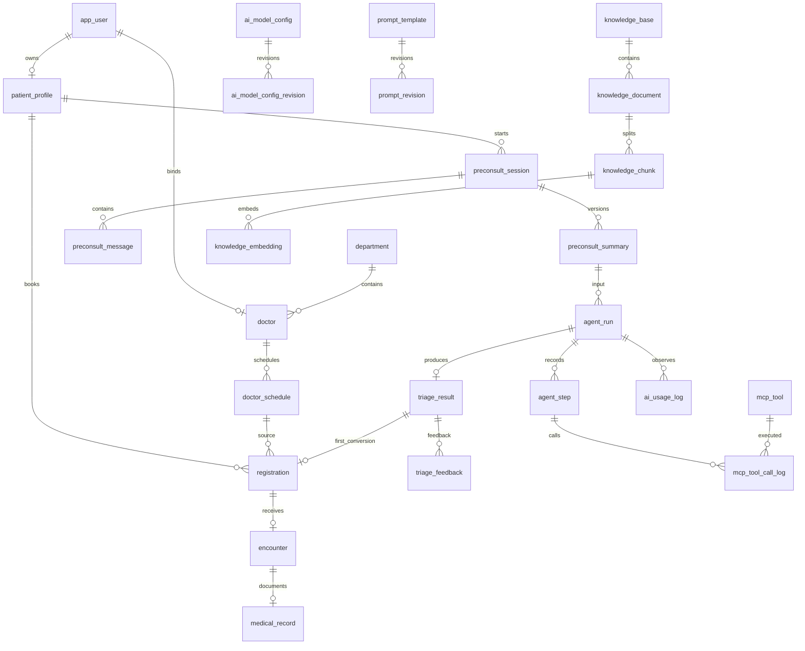

# 数据库与接口设计

本文件是《智能导诊系统开发文档》的可实施补充。表结构为设计规格，开发时转为 Flyway 迁移；示例 SQL 不自动执行，也不是完整建库脚本。

## 1. 通用约定

- MySQL 8，InnoDB，`utf8mb4`；业务编码唯一字段使用区分大小写或明确定义的规范化规则。
- 主键 `BIGINT UNSIGNED`，前端统一按字符串传递/展示，避免超过 JavaScript 安全整数范围。
- 时间 `DATETIME(3)`，数据库会话与应用统一使用 `+08:00 / Asia/Shanghai`；业务日期 `DATE`，API 时间输出 ISO 8601 与 `+08:00` 偏移。
- 通用字段：`created_at、updated_at`；可编辑配置表加 `created_by、updated_by、version`；逻辑删除按各表规则，不默认每表增加 deleted。
- 状态使用 `VARCHAR(24)` 和 Java Enum，不使用数据库 ENUM，便于迁移；应用校验状态全集与转换。
- 金额 `DECIMAL(10,2)`，货币第一版 CNY；比例由整数分子分母计算，不用浮点金额。
- 分页参数 `page>=1、1<=pageSize<=100`，默认 20；排序字段白名单，固定补 `id` 排序。
- 强关系建议真实外键 RESTRICT；不级联删除病历、预约或运行记录。逻辑引用和跨模块关联同时有服务层校验。
- JSON 只存可变 Schema、快照和结构化输出，不把需要筛选的日期、身份、状态全部塞 JSON。
- 敏感正文/密钥不得通过实体默认序列化到响应；DTO/VO 显式白名单。

## 2. 逻辑关系



图示体现业务关联。实际 FK 创建顺序应处理配置的 currentRevisionId 与历史修订等循环引用；可先创建表，再补外键。非关系数据库工具日志历史快照不能随配置删除丢失。

## 3. 表清单与优先级

| 分组 | 表 | 用途 | 交付优先级 |
|---|---|---|---|
| 身份 | app_user、auth_session | 账号、登录刷新/撤销 | P0 |
| 基础 | department、doctor、patient_profile | 科室、医生、患者 | P0 |
| 排班就诊 | doctor_schedule、registration、encounter、medical_record | 号源与门诊闭环 | P0 |
| 标签 | symptom_tag、symptom_department_rule | 症状与科室映射 | P0；后台完善 P1 |
| 问诊 | preconsult_session、preconsult_message、preconsult_summary | 消息、摘要修订 | P0 |
| 分诊 | triage_result、agent_run、agent_step、agent_run_event | 结果与事实时间线 | P0；回放 P1 |
| 工具 | mcp_tool、mcp_tool_call_log | 动态发现与执行 | P0 |
| AI | ai_model_config、ai_model_config_revision、prompt_template、prompt_revision、ai_usage_log | 配置与观测 | P0；回滚/面板 P1 |
| RAG | knowledge_base、knowledge_document、knowledge_chunk、knowledge_embedding、knowledge_ingest_job | 入库与索引版本 | P0；重建管理 P1 |
| 闭环治理 | triage_feedback、audit_log、idempotency_record | 反馈、审计、幂等 | 幂等与核心审计 P0；反馈 P1 |

共 33 张逻辑表。不为每个页面增加一个表；这些表分别承担独立状态、版本或多对多关系。个人开发可以先完成 P0 API，再补完整管理页面。

## 4. 身份与基础数据

### 4.1 app_user

| 字段 | 类型 | 约束/说明 |
|---|---|---|
| id | BIGINT UNSIGNED | PK |
| username | VARCHAR(64) | NOT NULL；注册时规范化；UK |
| password_hash | VARCHAR(100) | NOT NULL；BCrypt，不返回 |
| display_name | VARCHAR(64) | NOT NULL |
| phone | VARCHAR(24) | 可空；可选加密或脱敏策略 |
| role | VARCHAR(16) | PATIENT / DOCTOR / ADMIN；第一版单角色 |
| status | VARCHAR(16) | ACTIVE / DISABLED |
| token_version | INT UNSIGNED | 默认 0；撤销全部访问会话的版本号 |
| last_login_at | DATETIME(3) | 可空 |
| version | INT UNSIGNED | 编辑乐观锁 |

索引：`uk_username(username)`，`idx_role_status(role,status,id)`。管理员禁用不删除账号；医生开户时与 doctor 绑定在同一事务完成。

### 4.2 auth_session

字段：`id、user_id BIGINT、refresh_hash CHAR(64)、expires_at DATETIME(3)、revoked_at DATETIME(3) NULL、replaced_by_session_id BIGINT NULL、device_summary VARCHAR(200)、created_at、last_used_at`。

刷新 Token 使用高熵随机串，SHA-256 哈希存储，UK(refresh_hash)。access JWT 带 sessionId 与 tokenVersion。刷新采用轮换，旧会话刷新资格失效；并发刷新返回可恢复的明确错误，前端集中去重刷新。退出、禁用账号、修改密码分别撤销对应会话或全部会话。

索引：`idx_session_user(user_id,revoked_at,expires_at)`。不保存明文 Token 或完整敏感设备指纹。

### 4.3 department

字段：`id、code VARCHAR(32) UK、name VARCHAR(80)、description TEXT、location VARCHAR(120)、is_emergency TINYINT、status VARCHAR(16)、sort_no INT、version、created_by、updated_by、created_at、updated_at`。

唯一编码不可轻易修改；基础种子保证一个可识别急诊科。科室停用前显示影响的医生与未来场次；有历史关系不物理删除。索引 `(status,sort_no,id)`。

### 4.4 doctor

字段：`id、user_id BIGINT UK/FK、department_id BIGINT FK、name VARCHAR(64)、title VARCHAR(40)、specialty TEXT、introduction TEXT、avatar_key VARCHAR(255) NULL、status VARCHAR(16)、version、created_at、updated_at`。

索引 `(department_id,status,id)`。调整医生当前科室不更改既有排班/挂号科室快照；已有未来预约涉及转科时需要管理员明确处理。

### 4.5 patient_profile

字段：`id、user_id BIGINT UK/FK、real_name VARCHAR(64)、gender VARCHAR(16)、birth_date DATE NULL、age_years SMALLINT NULL、chronic_status VARCHAR(16)、chronic_history TEXT、allergy_status VARCHAR(16)、allergy_history TEXT、medication_status VARCHAR(16)、medication_history TEXT、emergency_contact VARCHAR(100) NULL、profile_version INT、created_at、updated_at`。三个 status 均取 UNKNOWN/NONE/KNOWN，默认 UNKNOWN；KNOWN 要求对应内容非空。

优先使用出生日期计算年龄；若只有年龄，记录 age_years 且不伪造生日。过敏/慢病明确区分 NONE、UNKNOWN、已填写内容，建议结构化 JSON 加文字说明。未补全档案不禁止浏览科室，但发起分诊时校验必要字段并补问。

## 5. 排班、挂号与病历

### 5.1 doctor_schedule

| 字段 | 类型 | 约束/说明 |
|---|---|---|
| id | BIGINT UNSIGNED | PK |
| doctor_id / department_id | BIGINT UNSIGNED | FK；排班所属科室固定 |
| visit_date | DATE | 本地业务日期 |
| time_slot | VARCHAR(8) | AM / PM |
| start_time / end_time | TIME | 场次起止 |
| booking_deadline | DATETIME(3) | 默认场次开始前 30 分钟，可配置 |
| total_count | INT UNSIGNED | >0 |
| remaining_count | INT UNSIGNED | 0..total_count；服务维护 |
| fee | DECIMAL(10,2) | >=0；仅费用展示 |
| status | VARCHAR(16) | OPEN / STOPPED / ARCHIVED |
| source_schedule_id | BIGINT UNSIGNED NULL | 复制来源；非历史改写 |
| shift_batch_id | VARCHAR(36) NULL | 复制/平移批次追踪 |
| version | INT UNSIGNED | 预约/取消/管理更新都递增 |
| remark | VARCHAR(255) NULL | 管理说明 |

约束：UK(doctor_id,visit_date,time_slot)；CHECK(total_count>0 AND remaining_count<=total_count AND fee>=0)。索引 `(department_id,visit_date,status)` 和 `(doctor_id,visit_date)`。

已有挂号场次不能直接改 visit_date、time_slot、doctor_id、department_id；总量调整锁行后根据占用数重算余号。

### 5.2 registration

| 字段 | 类型 | 约束/说明 |
|---|---|---|
| id | BIGINT UNSIGNED | PK |
| registration_no | VARCHAR(40) | UK；后端生成 |
| patient_id / schedule_id | BIGINT UNSIGNED | FK |
| doctor_id / department_id | BIGINT UNSIGNED | FK；挂号时固定 |
| triage_result_id | BIGINT UNSIGNED NULL | UK 可空；最多一条首次转化关联 |
| patient_name_snapshot | VARCHAR(64) | 挂号时姓名 |
| doctor_name_snapshot / department_name_snapshot | VARCHAR(80) | 历史展示用 |
| visit_date / time_slot | DATE / VARCHAR(8) | 挂号时日期时段快照 |
| fee_snapshot | DECIMAL(10,2) | 历史费用 |
| status | VARCHAR(24) | WAITING / IN_PROGRESS / COMPLETED / CANCELLED / NO_SHOW |
| active_guard | TINYINT GENERATED | WAITING/IN_PROGRESS=1，否则 NULL |
| cancelled_at / completed_at | DATETIME(3) NULL | 状态时间 |
| cancel_reason | VARCHAR(255) NULL | 用户/停诊取消原因 |
| version | INT UNSIGNED | 状态条件更新 |

索引：UK(patient_id,visit_date,time_slot,active_guard)；`(patient_id,created_at,id)`、`(doctor_id,visit_date,status,id)`、`(department_id,visit_date,status)`、`(created_at,status)`。

生成列示例：

```sql
active_guard TINYINT GENERATED ALWAYS AS
  (CASE WHEN status IN ('WAITING', 'IN_PROGRESS') THEN 1 ELSE NULL END) STORED,
UNIQUE KEY uk_patient_active_slot
  (patient_id, visit_date, time_slot, active_guard)
```

MySQL 唯一键允许多个 NULL，因此已取消/完成历史不冲突。同患者并发预约不同医生同一时段，唯一键使其中一个事务回滚并返还其扣减库存。

### 5.3 encounter

字段：`id、registration_id BIGINT UK/FK、doctor_id BIGINT、started_at DATETIME(3)、completed_at DATETIME(3) NULL、status VARCHAR(16) IN_PROGRESS/COMPLETED、version、created_at、updated_at`。

开始接诊条件更新 registration，再创建 encounter；整个动作短事务。重复开始返回已存在 encounter。索引 `(doctor_id,started_at,id)`。

### 5.4 medical_record

字段：`id、encounter_id BIGINT UK/FK、author_doctor_id BIGINT、chief_complaint TEXT、present_illness TEXT、past_history TEXT、physical_exam TEXT、auxiliary_exam TEXT、preliminary_diagnosis TEXT、treatment_plan TEXT、status VARCHAR(16) DRAFT/SUBMITTED、submitted_at DATETIME(3) NULL、version INT、created_at、updated_at`。

提交 SQL 必须带 `status='DRAFT' AND version=:version AND author_doctor_id=:currentDoctor`。SUBMITTED 正文后端不可更新；患者仅看到 SUBMITTED。管理员病历排障读取另记审计。

### 5.5 triage_feedback

字段：`id、triage_result_id BIGINT FK、encounter_id BIGINT UK/FK、doctor_id BIGINT、department_appropriate TINYINT、suggested_department_id BIGINT NULL、reason VARCHAR(500) NULL、feedback_version INT、created_at、updated_at`。

仅接诊医生可填写；不是诊断正确率。UI 可选“建议科室合适/应调整/无法判断”，无法判断不计入一致率有效分母，但统计覆盖率。

## 6. 标签、问诊与摘要

### 6.1 symptom_tag

字段：`id、code VARCHAR(64) UK、name VARCHAR(100)、aliases JSON、description TEXT、is_red_flag TINYINT、confirmation_question VARCHAR(500) NULL、status VARCHAR(16)、rule_revision INT、version、created_at、updated_at`。

`is_red_flag` 表示标签可能对应危急征象，不等于任意文本匹配立即急诊。实际判定结合确认答案、否定信息与强制规则版本。管理员不能通过停用普通检索标签关闭代码中的强制 SafetyPolicy。

### 6.2 symptom_department_rule

字段：`id、symptom_tag_id BIGINT FK、department_id BIGINT FK、weight DECIMAL(6,3)、condition_json JSON NULL、status VARCHAR(16)、version、created_at、updated_at`。

UK(symptom_tag_id,department_id)；索引 `(symptom_tag_id,status,weight)`。权重只是候选排序辅助，不直接解释为患病概率。

### 6.3 preconsult_session

字段：`id、patient_id BIGINT FK、title VARCHAR(100)、status VARCHAR(16)、current_summary_id BIGINT NULL、active_request_id VARCHAR(64) NULL、last_message_at DATETIME(3)、closed_at DATETIME(3) NULL、deleted_at DATETIME(3) NULL、version、created_at、updated_at`。

索引 `(patient_id,deleted_at,last_message_at,id)`。开始生成用条件更新占用 active_request_id，终止后清空。不能只依赖前端禁用发送按钮保证串行。

### 6.4 preconsult_message

字段：`id、session_id BIGINT FK、role VARCHAR(16) USER/ASSISTANT、client_message_id VARCHAR(64)、request_id VARCHAR(64)、content MEDIUMTEXT、status VARCHAR(16)、finish_reason VARCHAR(40) NULL、error_code VARCHAR(64) NULL、sequence_no INT、model_revision_id BIGINT NULL、prompt_revision_id BIGINT NULL、created_at、updated_at`。

UK(session_id,role,client_message_id)；UK(session_id,sequence_no)；索引 `(session_id,id)`、`(request_id)`。患者内容一次落库；assistant 定期批量持久化增量并在结束时写完整文本，避免每个 Token 都写数据库。

### 6.5 preconsult_summary

字段：`id、session_id BIGINT FK、revision INT、summary_json JSON、source_message_upto_id BIGINT、confirmed_by_patient TINYINT、confirmed_at DATETIME(3) NULL、patient_profile_snapshot JSON、safety_rule_version VARCHAR(40)、created_at`。

UK(session_id,revision)。摘要历史不可原地覆盖；用户修改或新一轮补问生成新 revision。Agent 记录 summary_id 和内容哈希，不依赖 session.current_summary_id 指针回溯。

## 7. Agent、工具与结果

### 7.1 agent_run

字段：`id、run_no VARCHAR(40) UK、patient_id BIGINT、session_id BIGINT、summary_id BIGINT、status VARCHAR(16)、trace_id VARCHAR(64)、request_id VARCHAR(64)、model_revision_id BIGINT、prompt_revision_id BIGINT、tool_snapshot JSON、knowledge_snapshot JSON、safety_rule_version VARCHAR(40)、max_rounds INT、max_tool_calls INT、actual_rounds INT、actual_tool_calls INT、started_at、finished_at、deadline_at DATETIME(3)、duration_ms BIGINT NULL、error_code VARCHAR(64) NULL、error_message VARCHAR(500) NULL、result_id BIGINT NULL、lease_owner VARCHAR(64) NULL、lease_until DATETIME(3) NULL、created_at、updated_at`。

索引 `(patient_id,created_at,id)`、`(status,deadline_at)`、`(trace_id)`。任务从 QUEUED 原子领取，记录租约；单机也要处理重启。运行中断不自动重复整段付费调用，标记失败并允许用户显式重试新运行。

### 7.2 agent_step

字段：`id、run_id BIGINT FK、sequence_no INT、round_no INT、step_type VARCHAR(24) MODEL/TOOL/SAFETY/VALIDATION/FINAL、status VARCHAR(16)、tool_code VARCHAR(100) NULL、tool_call_id VARCHAR(100) NULL、input_summary JSON、output_summary JSON、evidence_refs JSON、started_at、finished_at、duration_ms BIGINT、error_code VARCHAR(64) NULL、created_at`。

UK(run_id,sequence_no)；索引 `(run_id,round_no,sequence_no)`。只记录可核实行动，不增加 hiddenReasoning 字段。多个 tool calls 分别创建步骤。

### 7.3 agent_run_event

字段：`id、run_id BIGINT FK、sequence_no INT、event_type VARCHAR(24)、payload JSON、visibility VARCHAR(16) PATIENT/ADMIN、created_at`。

UK(run_id,sequence_no)；索引 `(run_id,visibility,sequence_no)`。`sequence_no` 是运行级持久事件号；SSE 使用该序号作为 id。患者过滤内部错误、隐私和完整工具原文，重订阅从 cursor 后重放公开事件。

### 7.4 triage_result

字段：`id、run_id BIGINT UK/FK、patient_id BIGINT、session_id BIGINT、summary_id BIGINT、primary_department_id BIGINT NULL、alternative_department_ids JSON、risk_level VARCHAR(16) ROUTINE/ATTENTION/EMERGENCY、recommendation_strength VARCHAR(16) SUFFICIENT/LIMITED/INSUFFICIENT、validation_status VARCHAR(24)、validated_doctor_options JSON、rationale TEXT、evidence_refs JSON、missing_information JSON、self_reported_confidence DECIMAL(5,4) NULL、status VARCHAR(16)、expires_at DATETIME(3)、first_registered_at DATETIME(3) NULL、created_at、updated_at`。

索引 `(patient_id,created_at,id)`、`(primary_department_id,created_at)`、`(risk_level,created_at)`。医生选项 JSON 是结果时的快照，确认预约必重查 schedule。`self_reported_confidence` 不返回患者，不作为诊断概率。

registration.triage_result_id 表示首次转化关联，取消也保留。首次转化与净转化分别按 linked registration 的 created_at/status 算，不依靠 result.status 字符串统计全部行为。

### 7.5 mcp_tool

字段：`id、code VARCHAR(100) UK、name VARCHAR(100)、description TEXT、input_schema JSON、executor_code VARCHAR(100)、status VARCHAR(16) ENABLED/DISABLED、timeout_ms INT、max_result_chars INT、sort_no INT、revision INT、version、created_at、updated_at`。

索引 `(status,sort_no,id)`。Schema 限深度/长度，不接受 arbitrary code。工具修改后 revision 增长；执行器列表是服务端白名单。第一版不包含 endpoint_url，避免误认为通用远程执行已经实现。

### 7.6 mcp_tool_call_log

字段：`id、run_id BIGINT NULL、step_id BIGINT NULL、tool_id BIGINT、tool_code_snapshot VARCHAR(100)、tool_revision INT、tool_call_id VARCHAR(100)、actor_user_id BIGINT、call_source VARCHAR(16) AGENT/ADMIN_TEST、input_redacted JSON、output_summary JSON、status VARCHAR(16)、started_at、finished_at、duration_ms BIGINT、error_code VARCHAR(64) NULL、trace_id VARCHAR(64)、created_at`。

索引 `(run_id,step_id)`、`(tool_id,created_at)`、`(status,created_at)`、`(trace_id)`。管理端测试同样使用授权测试患者，不允许任意患者 ID 越权读取。

## 8. AI 配置、Prompt 与用量

### 8.1 ai_model_config

字段：`id、code VARCHAR(64) UK、name VARCHAR(100)、model_type VARCHAR(16) CHAT/EMBEDDING、current_revision_id BIGINT、is_default TINYINT、status VARCHAR(16)、version、created_at、updated_at`。

默认配置的唯一性由同类型配置切换事务控制，并建议使用“启用且默认时生成 model_type，否则 NULL”的生成列唯一索引。模型修订创建前 config 可暂无 currentRevisionId，完整保存后才能启用。

### 8.2 ai_model_config_revision

字段：`id、config_id BIGINT FK、revision INT、provider VARCHAR(64)、base_url VARCHAR(500)、model_name VARCHAR(100)、api_key_ciphertext TEXT、key_version VARCHAR(32)、temperature DECIMAL(3,2) NULL、max_output_tokens INT NULL、timeout_ms INT、embedding_dimension INT NULL、capability_json JSON、build_fingerprint CHAR(64)、embedding_space_key VARCHAR(128) NULL、test_status VARCHAR(16)、tested_at DATETIME(3) NULL、created_by BIGINT、created_at`。

UK(config_id,revision)。发布后参数不可变；test_status 可另存测试结果或追加测试历史，不能变更模型参数。密钥采用带认证的加密格式并携带 key_version；不进入普通接口响应。

向量空间指纹针对会影响输出的模型/维度/归一化版本。仅凭据轮换不必重建全部向量，但必须保证新凭据访问同一模型空间；保留兼容凭据更新记录和测试。模型实现或维度变化必须新 spaceKey。

### 8.3 prompt_template / prompt_revision

`prompt_template`：`id、code VARCHAR(64) UK、name VARCHAR(100)、purpose VARCHAR(40)、draft_content MEDIUMTEXT、variable_schema JSON、current_revision_id BIGINT NULL、status VARCHAR(16)、version、created_at、updated_at`。

`prompt_revision`：`id、template_id BIGINT FK、revision INT、content MEDIUMTEXT、variable_schema JSON、content_hash CHAR(64)、change_note VARCHAR(500)、published_by BIGINT、published_at DATETIME(3)`；UK(template_id,revision)。发布做变量校验、长度校验和输出 Schema 测试，回滚只切当前指针，不删除历史。

### 8.4 ai_usage_log

| 字段 | 类型 | 说明 |
|---|---|---|
| id / trace_id / request_id | BIGINT / VARCHAR(64) | 主键与追踪 |
| run_id / step_id / ingest_job_id | BIGINT NULL | 关联上游 |
| actor_user_id | BIGINT NULL | 发起人 |
| purpose | VARCHAR(40) | 用途枚举 |
| model_revision_id / prompt_revision_id | BIGINT / BIGINT NULL | 精确配置 |
| provider / model_name_snapshot | VARCHAR(100) | 调用时显示信息 |
| attempt_no | INT | 同业务操作的重试编号 |
| status | VARCHAR(16) | RUNNING/SUCCEEDED/FAILED/TIMEOUT/CANCELLED |
| input_tokens / output_tokens / total_tokens | BIGINT NULL | 供应商缺失时 NULL |
| usage_source | VARCHAR(16) | PROVIDER/ESTIMATED/UNAVAILABLE；估算与真实分开汇总 |
| started_at / finished_at | DATETIME(3) | 调用起止 |
| first_token_latency_ms / duration_ms | BIGINT NULL | 首增量与全程耗时 |
| error_code / error_message_zh | VARCHAR(64)/VARCHAR(500) NULL | 统一错误 |
| provider_error_redacted | TEXT NULL | 受控脱敏排障 |
| request_summary / response_summary | JSON NULL | 摘要，默认不保存完整病史 |

索引 `(started_at,purpose)`、`(purpose,status,started_at)`、`(run_id,step_id)`、`(trace_id)`。Token 汇总同时返回可用记录数和总记录数；不把 NULL 当成零消耗展示。

## 9. 知识库与向量任务

### 9.1 knowledge_base

字段：`id、code VARCHAR(64) UK、name VARCHAR(100)、description TEXT、status VARCHAR(16)、active_space_key VARCHAR(128) NULL、active_index_version BIGINT NULL、target_model_revision_id BIGINT NULL、version、created_at、updated_at`。

发布索引只更新 active 指针，不能在重建开始时覆盖；查询使用 active 对应模型空间。

### 9.2 knowledge_document

字段：`id、base_id BIGINT FK、title VARCHAR(200)、source_name VARCHAR(200)、source_url VARCHAR(1000) NULL、document_version VARCHAR(100)、published_date DATE NULL、valid_until DATE NULL、file_key VARCHAR(255)、mime_type VARCHAR(100)、file_size BIGINT、file_sha256 CHAR(64)、status VARCHAR(24)、review_status VARCHAR(16)、parse_error VARCHAR(1000) NULL、created_by BIGINT、created_at、updated_at`。

UK(base_id,file_sha256,document_version)；索引 `(base_id,status,review_status,id)`。有效性规则：未审核或过期文档不能进入新发布版本。上传同文件返回已有记录或明确创建新文档版本。

### 9.3 knowledge_chunk

字段：`id、document_id BIGINT FK、chunk_no INT、title_path VARCHAR(500)、content MEDIUMTEXT、content_hash CHAR(64)、page_start/page_end INT NULL、paragraph_start/paragraph_end INT NULL、char_count INT、token_count_estimate INT NULL、split_revision VARCHAR(40)、status VARCHAR(16)、created_at`。

UK(document_id,split_revision,chunk_no)。发布后正文不可改写；重解析产生新 splitRevision，旧索引仍关联旧片段。引用依据为真实定位，不虚构 DOCX 页码。

### 9.4 knowledge_embedding

字段：`id、chunk_id BIGINT FK、base_id BIGINT、model_revision_id BIGINT、space_key VARCHAR(128)、index_version BIGINT、dimension INT、vector_blob MEDIUMBLOB、vector_norm DOUBLE、status VARCHAR(16)、error_code VARCHAR(64) NULL、created_at、updated_at`。

UK(chunk_id,space_key,index_version)；索引 `(base_id,space_key,index_version,status,chunk_id)`。`vector_blob` 为 float32 little-endian；校验字节数=`dimension*4`，范数>0且有限。不是 MySQL 原生 VECTOR 字段。

同一发布版本不得混入不同空间；查询先按 base/space/version/READY 筛选。相似度排序由 Java 完成，SQL `ORDER BY` 不能假装已有向量函数。

### 9.5 knowledge_ingest_job

字段：`id、job_no VARCHAR(40) UK、base_id BIGINT、document_id BIGINT NULL、job_type VARCHAR(16) INGEST/REBUILD、target_model_revision_id BIGINT、target_space_key VARCHAR(128)、target_index_version BIGINT、status VARCHAR(24)、total_items INT、completed_items INT、failed_items INT、progress_json JSON、error_message VARCHAR(1000) NULL、attempt_no INT、lease_owner VARCHAR(64) NULL、lease_until DATETIME(3) NULL、started_at、finished_at、created_by、created_at、updated_at`。

索引 `(status,created_at)`、`(base_id,target_index_version)`。任务可按片段幂等重试；只重试失败/缺失片段。全量完整性检查通过才发布。使用受限并发与批量 Embedding，避免长事务和文档解析占满 Web 线程。

## 10. 审计与幂等

### 10.1 audit_log

字段：`id、actor_user_id BIGINT、actor_role VARCHAR(16)、action VARCHAR(100)、resource_type VARCHAR(64)、resource_id VARCHAR(64)、before_redacted JSON NULL、after_redacted JSON NULL、reason VARCHAR(500) NULL、trace_id VARCHAR(64)、created_at`。

索引 `(resource_type,resource_id,created_at)`、`(actor_user_id,created_at)`、`(action,created_at)`。API Key 与病历正文不复制到 before/after；病历访问记录对象与原因即可。

### 10.2 idempotency_record

字段：`id、user_id BIGINT、operation VARCHAR(64)、idempotency_key VARCHAR(100)、request_hash CHAR(64)、status VARCHAR(16) PROCESSING/SUCCEEDED、resource_id VARCHAR(64) NULL、response_json JSON NULL、expires_at DATETIME(3)、created_at、updated_at`。

UK(user_id,operation,idempotency_key)，索引 `(expires_at)`。挂号、分诊创建、批量排班复制使用幂等；记录与业务写入在同一事务提交。唯一键竞争失败后读取已提交记录返回同一资源；处理中返回 409 + requestId 或稍后查询，不创建第二条业务。

首次成功后同键不同请求体返回 IDEMPOTENCY_CONFLICT。失败且事务回滚时幂等占位也回滚；数据库持久化 PROCESSING 的异步任务必须有超时/租约恢复规则，不能永久卡住。

## 11. 通用 REST 契约

### 11.1 URL、响应和状态码

前缀 `/api/v1`；角色路径 `/patient`、`/doctor`、`/admin`。这些路径不替代后端权限校验。

成功：

```json
{
  "code": "OK",
  "message": "成功",
  "data": {"id": "10001"},
  "traceId": "trace-001"
}
```

分页：

```json
{
  "code": "OK",
  "data": {
    "items": [],
    "total": 0,
    "page": 1,
    "pageSize": 20
  },
  "traceId": "trace-001"
}
```

失败：

```json
{
  "code": "SCHEDULE_VERSION_CONFLICT",
  "message": "号源已更新，请重新确认场次",
  "data": {"scheduleId": "501", "latestVersion": 9},
  "traceId": "trace-001"
}
```

HTTP：200 查询/更新，201 创建，202 异步接受，400 格式错误，401 未登录/会话失效，403 权限不足，404 资源不可见或不存在，409 状态/库存/版本/幂等冲突，422 业务前置条件不满足，429 频率/并发限制，503 模型或索引不可用，500 未预期异常。前置失败不统一包装成 HTTP 200。

敏感资源可统一返回 404 隐藏存在性；管理排障通过 traceId。SSE 开始后不再返回普通 JSON，发送 `error` 并关闭流；终态落库。

### 11.2 认证接口

| 方法 | 路径 | 请求/响应 |
|---|---|---|
| POST | /auth/register | username/password/displayName；仅患者角色，role 参数拒绝 |
| POST | /auth/login | 账号密码；返回 accessToken、expiresIn、user；刷新 Cookie 同源写入 |
| POST | /auth/refresh | 刷新 Cookie；轮换刷新会话并返回新 accessToken |
| POST | /auth/logout | 撤销当前会话并清 Cookie |
| GET | /auth/me | 当前账号/角色/关联 doctorId 或 patientId |
| PATCH | /auth/password | oldPassword/newPassword；撤销其他会话 |

## 12. 患者端接口

| 方法 | 路径 | 关键契约 |
|---|---|---|
| GET/PATCH | /patient/profile | 本人档案；PATCH 带 profileVersion |
| GET | /departments | 只返回启用科室，不含后台敏感配置 |
| GET | /doctors/{id} | 医生公开介绍与科室 |
| GET | /schedules | departmentId/doctorId/startDate/endDate；公开未来七天有效场次 |
| GET | /schedules/{id} | 实时余号、版本、费用、日期、bookingDeadline |
| POST | /patient/preconsult-sessions | title 可选；创建本人 ACTIVE 会话 |
| GET | /patient/preconsult-sessions | 分页历史，排除 deleted |
| GET | /patient/preconsult-sessions/{id} | 会话+摘要+消息分页，不泄漏后台 Prompt |
| DELETE | /patient/preconsult-sessions/{id} | 逻辑删除；先停止活动任务或返回冲突 |
| POST | /patient/preconsult-sessions/{id}/messages/stream | body: clientMessageId/content；前置 JSON，接受后 SSE |
| GET | /patient/preconsult-requests/{requestId} | 消息终态与最终正文，断流恢复 |
| POST | /patient/preconsult-requests/{requestId}/cancel | 协作取消；重复取消幂等 |
| POST | /patient/preconsult-sessions/{id}/summaries/confirm | summaryRevision/summary；编辑后生成确认版本 |
| POST | /patient/triage-runs | sessionId/summaryId；Idempotency-Key；202+runId/eventsUrl |
| GET | /patient/triage-runs/{id} | 公开运行状态、resultId、有限错误 |
| GET | /patient/triage-runs/{id}/events | fetch SSE；cursor 或 Last-Event-ID；只重放公开事件 |
| POST | /patient/triage-runs/{id}/cancel | 取消未结束运行，后台停止后落 CANCELLED |
| GET | /patient/triage-results/{id} | 本人验证后结果、引用和医生候选 |
| POST | /patient/registrations | scheduleId/expectedVersion/triageResultId?；Idempotency-Key |
| GET | /patient/registrations | 本人状态筛选分页 |
| GET | /patient/registrations/{id} | 快照、状态、接诊信息和公开摘要 |
| POST | /patient/registrations/{id}/cancel | cancelReason；截止规则与 WAITING 状态检查 |
| GET | /patient/registrations/{id}/medical-record | 仅 SUBMITTED 本人病历 |

### 12.1 挂号请求

```http
POST /api/v1/patient/registrations
Authorization: Bearer <access-token>
Idempotency-Key: reg-client-uuid-001
Content-Type: application/json
```

```json
{
  "scheduleId": "501",
  "expectedVersion": 8,
  "triageResultId": "901"
}
```

不接收 patientId、doctorId、fee、visitDate 作为可信值。后端根据身份和 schedule 取得并快照；triageResultId 必须属于本人、有效且首次未关联，场次科室必须属于已核验推荐集合，急诊结果不能作为普通预约转化。若用户主动改选其他科室，前端清除 triageResultId 按普通预约提交；后端拒绝错误关联，防止抬高推荐转化。

### 12.2 分诊结果响应示例

```json
{
  "id": "901",
  "riskLevel": "ROUTINE",
  "riskLabel": "未确认急诊征象，建议按以下科室咨询",
  "recommendationStrength": "SUFFICIENT",
  "department": {"id": "3", "name": "呼吸内科"},
  "rationale": "根据已确认的咳嗽持续时间和伴随症状，建议先咨询呼吸内科。",
  "missingInformation": [],
  "doctorOptions": [
    {"doctorId": "21", "scheduleId": "501", "remaining": 6, "version": 8}
  ],
  "evidence": [
    {"chunkId": "77", "title": "门诊导诊说明", "page": 3, "excerpt": "相关知识片段"}
  ],
  "expiresAt": "2026-10-09T10:00:00+08:00",
  "status": "READY"
}
```

这是协议示例，不是已验证的医学建议。相似度不渲染为“准确率”，无医生时 doctorOptions 为空并显示无号源。

### 12.3 Agent 进度事件

事件类型 `run_started / step_started / step_finished / validation / result_ready / run_failed / run_cancelled`。

```text
id: 3
event: step_finished
data: {"runId":"801","seq":3,"label":"已查询可预约排班","durationMs":42,"status":"SUCCEEDED"}

```

cursor 只能在该 runId 内使用。返回持久公开事件后订阅新事件；处理“重放结束与实时订阅之间”的竞争，可用持续按序拉取事件表补齐，前端按 seq 去重。终态发送最终事件后关闭。

## 13. 医生端接口

| 方法 | 路径 | 关键契约 |
|---|---|---|
| GET | /doctor/workbench | 当日 WAITING/IN_PROGRESS/COMPLETED 汇总 |
| GET | /doctor/registrations | date/status/keyword；仅当前医生 |
| GET | /doctor/registrations/{id} | 关联档案、确认摘要与登记快照；记录必要访问审计 |
| POST | /doctor/registrations/{id}/start | expectedVersion；返回 encounter，重复调用不重复创建 |
| GET | /doctor/encounters/{id}/medical-record | 本人接诊草稿/提交版本 |
| PUT | /doctor/encounters/{id}/medical-record/draft | 七段正文+version；409 防止覆盖 |
| POST | /doctor/encounters/{id}/medical-record/submit | version；正文锁定 |
| POST | /doctor/encounters/{id}/complete | 已提交病历才允许完成；同步挂号状态 |
| POST/PUT | /doctor/encounters/{id}/triage-feedback | appropriate/adjust/uncertain；建议科室和原因 |
| GET | /doctor/schedules | 本人日期范围，不提供修改余号能力 |

提交与完成可使用两个明确操作，也可提供一个组合事务按钮“提交病历并完成就诊”；组合端点必须一次性验证并原子提交，不能前端连续两次请求后误报整体成功。

## 14. 管理端接口

### 14.1 基础管理

| 资源 | 方法与路径 | 关键规则 |
|---|---|---|
| 用户 | GET /admin/users；POST/PATCH /admin/users/{id}/status | 禁用撤销会话；账号身份不能任意转角色 |
| 科室 | GET/POST /admin/departments；PATCH /admin/departments/{id} | status/version；急诊配置缺失告警 |
| 医生 | GET/POST /admin/doctors；PATCH /admin/doctors/{id} | 创建可同时开通医生账号；密码不返回历史 |
| 排班 | GET/POST /admin/schedules；PATCH /admin/schedules/{id} | 总量计算、日期锁定、版本条件更新 |
| 停诊 | POST /admin/schedules/{id}/stop | reason；展示待处理预约，批量取消独立明确执行 |
| 复制排班 | POST /admin/schedule-shifts/preview；POST /admin/schedule-shifts | 模式、源 ID、目标起始日、previewHash、Idempotency-Key |
| 患者档案 | GET /admin/patient-profiles；PATCH /admin/patient-profiles/{id} | 访问/修改审计，不默认导出完整病史 |
| 症状与规则 | CRUD /admin/symptom-tags、/admin/symptom-department-rules | revision、version；停用不关闭强制规则 |

列表 GET、创建 POST、修改 PATCH、逻辑删除/归档 DELETE 的具体资源 ID 必须固定；编码不可通过通用表单任意改变。

### 14.2 AI、Prompt 与工具

| 方法 | 路径 | 契约 |
|---|---|---|
| GET/POST | /admin/ai-model-configs | 查询不含密钥明文；创建 CHAT/EMBEDDING 配置 |
| PATCH | /admin/ai-model-configs/{id} | 创建新修订，apiKey 空字符串不能误清已有密钥 |
| POST | /admin/ai-model-configs/{id}/test | 指定 draft/revision、能力；返回耗时、维度/usage 能力 |
| POST | /admin/ai-model-configs/{id}/activate | 已测通过修订变默认；新请求生效 |
| GET | /admin/ai-model-configs/{id}/revisions | 版本元数据，无 key |
| GET/POST/PATCH | /admin/prompt-templates | 草稿列表/新建；修改使用 /{id}，带 version |
| POST | /admin/prompt-templates/{id}/publish | 校验变量、revision、changeNote |
| POST | /admin/prompt-templates/{id}/rollback | targetRevision；切指针且审计 |
| GET | /admin/tool-executors | 服务端已实现执行器和允许 Schema |
| GET/POST | /admin/tools | 数据库工具登记 |
| PATCH | /admin/tools/{id} | 名称/说明/Schema/执行器，revision 增长 |
| POST | /admin/tools/{id}/status | 启用/停用真实影响执行 |
| POST | /admin/tools/{id}/test | 授权合成测试数据，调用日志标 AGENT/ADMIN_TEST |
| GET | /admin/tool-call-logs | tool/run/date/status 筛选分页 |

API Key 编辑：提交 `apiKey` 为新值才替换；不提交则保留；专门 `clearApiKey=true` 需确认并停用。前端不能把掩码 `sk-****` 当作新 key 发送。

### 14.3 RAG 与观测

| 方法 | 路径 | 契约 |
|---|---|---|
| GET/POST/PATCH | /admin/knowledge-bases | 修改使用 /{id}；active 与 target 分开 |
| POST | /admin/knowledge-bases/{id}/documents | multipart/file/source/version；202+jobId |
| GET | /admin/knowledge-documents | base/status/review 筛选 |
| GET | /admin/knowledge-documents/{id}/chunks | 切分版本、正文与来源定位 |
| POST | /admin/knowledge-documents/{id}/review | 审核状态与说明 |
| GET | /admin/knowledge-jobs/{id} | 状态、进度、失败片段、目标版本 |
| POST | /admin/knowledge-jobs/{id}/retry | 仅重试失败项，预算明确 |
| POST | /admin/knowledge-bases/{id}/rebuild | 目标模型修订，异步全量重建 |
| POST | /admin/knowledge-bases/{id}/publish | 完整性通过的 job/indexVersion |
| POST | /admin/knowledge-retrieval/test | baseId/query/topK；返回 score、chunk、space/version、耗时 |
| GET | /admin/agent-runs | 日期/状态/trace 筛选 |
| GET | /admin/agent-runs/{id} | 脱敏步骤、版本、证据、错误 |
| GET | /admin/ai-usage/summary | date/purpose/model；统计、缺失 usage 比例 |
| GET | /admin/ai-usage/logs | 明细分页，筛选与 summary 一致 |
| GET | /admin/ai-usage/logs/{id} | 权限控制的脱敏请求/结果摘要 |
| GET | /admin/operations/summary | startDate/endDate/dateBasis/observedAt |
| GET | /admin/operations/departments | 科室维度 |
| GET | /admin/operations/doctors | 医生维度 |
| GET | /admin/operations/recommendations | 推荐科室维度与观察期/分子/分母 |
| GET | /admin/audit-logs | 操作审计 |

知识原文件下载只对管理员或允许用户提供受控端点，不能直接把上传目录作为 Nginx 公共静态目录暴露。

## 15. 核心事务伪代码与索引检查

### 15.1 预约

```text
BEGIN
  插入 idempotency_record，占用 (user, REGISTER, key)
  若已成功存在：校验 requestHash，返回同一挂号，不重复执行
  锁/更新 schedule：OPEN、未截止、余号>0、版本匹配
  插入 registration：服务端快照，唯一患者时段，triage 首次关联唯一
  若来自 triage：验证本人、常规有效结果，更新 CONSUMED/firstRegisteredAt
  幂等记录更新 SUCCEEDED + resourceId + 安全响应
COMMIT
```

SQL 唯一冲突、状态冲突、库存更新失败均回滚。不要先扣号并提交，再创建挂号；不要在事务中请求模型。

### 15.2 取消

```text
先读取挂号归属和 scheduleId
BEGIN
  SELECT schedule FOR UPDATE
  SELECT registration FOR UPDATE
  重新检查归属、WAITING、截止时间
  若已取消：返回现状，不返号
  UPDATE registration 为 CANCELLED 并记原因
  UPDATE 原 schedule 余号 +1、version +1
  验证余号不超过总量
COMMIT
```

停诊批量取消采用相同锁顺序，分小批执行并显示处理结果。低资源环境不能把成千条预约放进一个长事务。

### 15.3 发布知识索引

```text
后台完成 parse/chunk/embed，检查片段与向量总数及空间一致性
BEGIN
  锁定 knowledge_base，检查当前 version 与目标 job READY
  更新 activeSpaceKey/activeIndexVersion/对应模型空间信息
  写审计与任务发布状态
COMMIT
缓存按新版本构建/切换，旧版本等待保留期后清理
```

分页与统计 SQL 上线前用 EXPLAIN 检查患者列表、医生当日列表、未来七天排班、运行明细、用途聚合与向量候选筛选。按真实查询加复合索引，不给每一列都单独建索引。

## 16. 种子数据与迁移约定

建议初始化：1 管理员、3–6 医生、10 合成患者；8–10 科室含急诊；未来七天 40–80 场排班；30–50 症状标签；6 个已实现工具；3 组知识库、10–20 个可用演示文档；4 类 Prompt 模板。

模型配置初始化为空：管理员输入自己的 API Key 并分别完成 chat/tools/stream/embed 测试。种子脚本不提交任何实际密钥、生产账号或真实患者信息；演示密码由首次启动环境输入或随机生成，不在报告截图中暴露。

迁移命名建议 `V1__identity_masterdata.sql`、`V2__appointment_encounter.sql`、`V3__ai_preconsult_agent.sql`、`V4__knowledge_observability.sql`。结构迁移与演示种子分开；自动生成排班必须使用当前业务日期，不能依赖原型中的 2026-09 日期。

接口实现后生成 OpenAPI JSON/YAML 并与本文件核对，尤其校验 ID 字符串、状态码、可空 Token、权限、SSE 事件与日期口径。本文不是已实现服务的 OpenAPI 导出。
