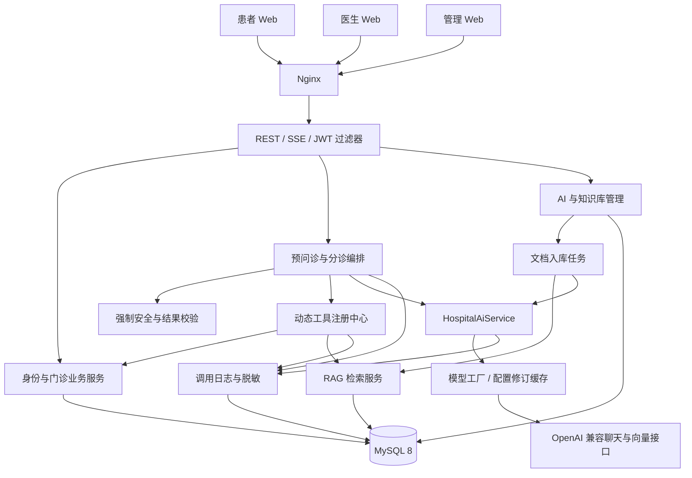
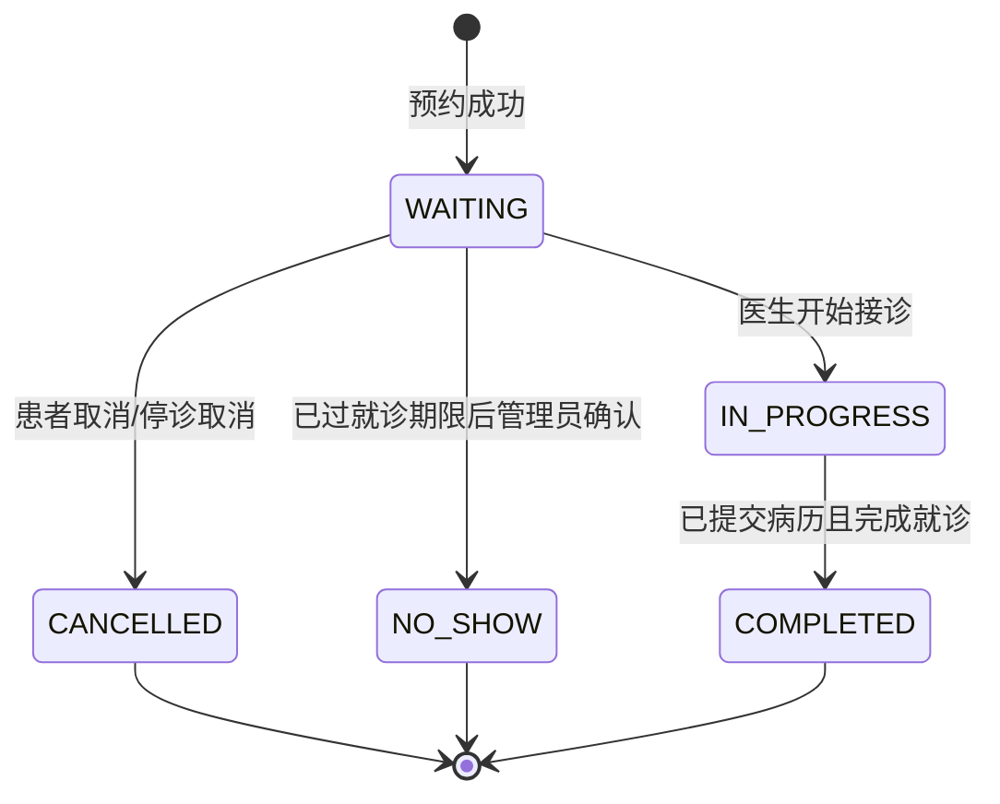

# 医路智诊：基于 RAG 与工具调用 Agent 的智能导诊系统开发文档

| 项目项 | 内容 |
|---|---|
| 文档版本 | V1.0 · 2026-10-08 |
| 建议毕设题目 | 基于检索增强生成与工具调用智能体的医院智能导诊系统设计与实现 |
| 建议实习项目名称 | 医路智诊 · 医院预问诊与门诊协同平台 |
| 项目形态 | Vue 3 Web 应用 + Spring Boot 模块化单体 + MySQL 8 |
| 目标使用者 | 患者、医生、管理员 |
| 参考材料 | 项目 `原型图/1.png` 至 `原型图/11.png`，已逐张审阅 |
| 文档性质 | 待开发的设计规格；文中的性能、效果指标是验收目标，不是已测结果 |
| 默认规模 | 单医院、个人或 2–3 人开发、约 10–12 周、使用合成病例演示 |

配套文档：[页面与交互设计](页面与交互设计.md)、[数据库与接口设计](数据库与接口设计.md)、[验收与答辩方案](验收与答辩方案.md)。

## 1. 项目定位与边界

项目帮助患者把自然语言症状整理为预问诊摘要，结合医学知识片段、症状标签、科室信息和可挂号排班，提供可追溯的科室建议，完成预约、医生接诊、电子病历查看的业务闭环。

患者端突出“下一步去哪里、需要补充什么、能否预约”；医生端突出“快速了解病情、书写病历、完成接诊”；管理端突出“基础数据、AI 配置、知识质量、调用观测”。三端使用同一套业务数据和权限规则。

### 1.1 基线范围

- 一位患者账号对应一份个人档案；一个医生账号绑定一位医生；公开注册只能创建患者账号。
- 单医院、门诊预约、按日期和上午/下午时段排班；暂不接入外部 HIS。
- 挂号费仅展示与快照，不实现真实支付、医保结算或退费。
- AI 提供导诊与信息整理；诊断、处方、病历正文由医生确认和提交。
- 知识库先支持 PDF、DOCX、TXT；扫描 PDF、图片 OCR、复杂表格解析作为后续扩展。
- 工具中心第一版管理后端已实现的只读工具；远程 MCP 协议连接属于独立扩展。
- 支持桌面管理端、桌面医生端和适配手机的患者 Web 端，不单独开发小程序或原生 App。

### 1.2 推荐的优化

| 原方案 | 优化后设计 | 对毕设/实习的价值 |
|---|---|---|
| 展示模型给出的 88% 置信度 | 患者看到“推荐依据充分/需补充信息”；模型自评分仅作内部调试，后续用标注集校准 | 避免把未验证的模型估计包装成诊断概率 |
| “推荐命中率”按挂号计算 | 拆成首次挂号转化率、当前有效挂号转化率、医生反馈一致率 | 指标口径可解释，可开展离线实验 |
| Agent 时间线展示推理 | 展示实际调用、输入摘要、证据引用、校验与结果；不要求记录模型隐藏思维链 | 可回放真实行为，便于调试与评审 |
| 工具表名叫 mcp_tool | 说明是“数据库驱动本地工具注册中心”；真正接入 MCP 时另加适配器 | 技术表述准确，不以表名替代协议实现 |
| MySQL 向量表直接检索 | MySQL 存向量，Java 按知识库筛选并计算余弦相似度，小规模缓存；大规模另选向量引擎 | 算法与成本边界清晰，符合 MySQL 8 约束 |
| 改模型配置立即生效 | 保存后下一次新请求生效；运行中的会话轮次/Agent 固定配置修订 | 可复现，避免同一次任务混用模型和 Prompt |
| 已分诊后会话直接锁死 | 每次分诊关联摘要版本；结果页允许复制症状到新会话 | 保留历史且有明确的继续问诊路径 |
| 顺延旧排班并复位余号 | 演示数据无预约时允许平移；有预约时复制到未来形成新场次，历史场次保留 | 避免超卖、历史预约与配置不一致 |
| 只提供 CRUD 和 AI 演示 | 加入幂等、并发挂号、权限隔离、超时终止、版本追溯和评测 | 体现实习可用的工程能力 |

## 2. 原型审阅与需求映射

以下观察仅来自本地 11 张图片。未看到的页面按新需求补充，不当作已有原型。

| 图片 | 实际内容 | 保留部分 | 需要改进的部分 |
|---|---|---|---|
| 1.png | 蓝色背景登录卡片、账号密码、注册链接 | 简洁入口与品牌 | 输入标签、密码显隐、错误反馈、键盘操作、移动适配 |
| 2.png | 患者首页、四个快捷入口、就诊流程 | 预问诊/挂号/就诊/档案导航 | 用待办和最近预约替代大面积欢迎横幅；首屏一个主操作 |
| 3.png | 历史会话、对话区、顶部推荐结果、已分诊锁定状态 | 会话列表与流式聊天 | 结果与对话分层；加入补问进度、证据、执行状态、重新问诊入口 |
| 4.png | 科室、七天日期、医生排班卡片、余号和费用 | 日期与科室筛选 | 加入推荐筛选标识、医生详情、确认预约、余号冲突刷新、停诊提示 |
| 5.png | 我的就诊背景上的电子病历弹窗 | 结构化病历与提交时间 | 长病历改详情页或大抽屉；明确已提交只读、打印范围 |
| 6.png | 管理首页、左侧分组导航、功能导览、业务闭环 | 分组导航与功能关系 | 首页优先展示告警、任务和统计；减少纯说明卡片 |
| 7.png | 排班表格、筛选、新增、批量删除、日期顺延 | 基础表格工作流 | 有预约场次不物理删除；顺延前预览影响和冲突；增加停诊处理 |
| 8.png | 知识片段语义检索、向量模型/维度/状态、重新生成 | 检索调试入口和状态列 | 显示相似度、引用定位、索引版本、失败原因；批量任务可重试 |
| 9.png | 运营 KPI、近期挂号柱状图、科室/医生/推荐维度 | 三维汇总 | 加时间筛选、分母说明、样本量；“命中率”改正确业务口径 |
| 10.png | AI 调用 KPI、用途汇总、明细筛选 | 统计与明细联动 | 增加首字延迟、P95、Token 缺失标识、错误分类、关联 traceId |
| 11.png | 六种已实现工具、启用开关、编辑/执行/删除 | 动态可用工具列表 | 区分登记与实现；工具测试只用授权测试数据；开关审计与运行版本 |

**待补页面**：患者档案、分诊完整结果、挂号确认、就诊详情、医生工作台、七段病历编辑器、AI 配置测试、Prompt 修订、文档入库任务、Agent 运行详情、症状标签与规则维护。

## 3. 角色权限与业务职责

### 3.1 权限矩阵

| 能力 | 患者 | 医生 | 管理员 |
|---|---|---|---|
| 查看/修改个人档案 | 自己 | 获授权接诊患者只读 | 按管理权限维护，访问有审计 |
| 预问诊与分诊 | 自己 | 查看关联就诊摘要 | 查看脱敏统计，排障时受控查看 |
| 预约/取消预约 | 自己且符合状态规则 | 不代替患者任意预约 | 停诊处理、异常协助，有操作记录 |
| 就诊与病历 | 自己；正文提交后可见 | 仅自己的挂号患者 | 默认只看运营字段；病历正文按额外权限访问 |
| 编辑/提交病历 | 无 | 自己接诊的草稿 | 无直接修改已提交正文权限 |
| 医生/科室/排班管理 | 无 | 查看自己的排班 | 管理 |
| 模型/Prompt/知识库/工具管理 | 无 | 无 | 管理，凭据不可回显 |
| AI/Agent 观测 | 自己的状态和公开证据 | 关联接诊摘要 | 全局脱敏观测、运行明细 |
| 导出统计 | 无 | 自己的工作统计 | 按授权导出脱敏数据 |

前端菜单仅用于导航。后端在服务层同时检查角色、资源归属和业务状态；患者 ID、医生 ID 从登录身份取得，不能直接信任请求参数。

### 3.2 用户场景

1. 患者注册登录，补充年龄、性别、慢病史、过敏史。
2. 患者描述症状，AI 每轮最多提出 2–3 个关键问题；系统逐轮维护摘要。
3. 患者确认摘要并点击“获取科室建议”，生成分诊任务。
4. 系统先进行危急征象核验，再调用 Agent 和只读工具；检查真实科室与可预约医生。
5. 患者查看推荐依据和知识来源，选择场次并确认预约。
6. 医生在工作台查看挂号与摘要，开始接诊，书写草稿并提交病历。
7. 患者在我的就诊查看已提交病历；管理员在看板追踪转化与调用质量。

## 4. 功能分层与工作量控制

优先级定义：P0 必须形成可演示闭环；P1 使原方案完整并适合答辩；P2 为时间允许时的加分项。最终完整版应完成 P0+P1；P0 只是开发阶段的最小交付。

| 模块 | P0 | P1 | P2 |
|---|---|---|---|
| 账号权限 | JWT、三角色、资源归属、账号禁用 | 登录会话撤销、操作审计完善 | 精细权限配置、统一身份认证 |
| 基础数据 | 科室、医生账号、患者档案、排班 | 标签/科室映射管理、模板排班、未来排班复制 | 多院区、多就诊人 |
| 门诊闭环 | 预约、取消、开始接诊、草稿、提交、完成就诊 | 停诊处理、医生分诊反馈、就诊摘要 | 候诊签到、通知、复诊预约 |
| 预问诊 | 真实 SSE、历史会话、停止、失败处理 | 摘要编辑确认、历史继续入口、Token 上限 | 语音输入、OCR |
| 分诊 Agent | 动态工具池、有限循环、硬校验、危急拦截 | 运行回放、证据引用、低依据降级 | 人工分诊队列、多 Agent 协同 |
| 医学 RAG | 三类文档、切分、向量、来源引用 | 任务重试、版本切换、检索调试、效果评测 | 重排模型、混合检索、独立向量库 |
| AI 配置 | 聊天/Embedding 分离、加密密钥、连接测试 | Prompt 发布回滚、配置修订与缓存失效 | 多供应商策略与成本路由 |
| 可观测性 | 四类 AI 调用日志、Agent 步骤、工具日志 | 首字/P95、用途统计、三维运营看板 | 实时告警、集中式追踪 |

不建议第一版同时加入付费、药品、检验、医保、远程视频问诊。这些不增加核心技术证明，却会显著增加业务范围。

## 5. 技术选型与版本策略

| 层 | 选型 | 约束与用途 |
|---|---|---|
| Java | JDK 21 LTS | Maven 编译 release=21；开发/CI/镜像统一 |
| 后端框架 | Spring Boot 3.5.x | 锁定可获取且相互兼容的具体补丁版本；使用 Spring MVC |
| AI SDK | LangChain4j 1.x 的 langchain4j-open-ai | 普通依赖，不使用自动注入模型的 starter；模型由数据库配置工厂创建 |
| 持久层 | MyBatis + PageHelper | XML 管理复杂 SQL；分页必须稳定排序，禁止对 SSE 或异步任务使用线程残留分页 |
| 工具/认证 | Hutool、Java JWT、Bean Validation、BCrypt | Hutool 辅助通用处理；密码使用 BCrypt；JWT 验签并检查账号/会话状态 |
| 数据库 | MySQL 8.0.36+ 或 8.4 | InnoDB、utf8mb4；不用 MySQL 9 向量特性，也不假设有原生向量索引 |
| 文档解析 | Apache Tika 或分格式解析器 | PDF/DOCX/TXT；限定大小和页数；解析失败可诊断 |
| 前端 | Vue 3.5.x、Vue Router 4、Axios、Element Plus 2.x | TypeScript、组合式 API；Pinia 只管理登录与跨页面状态 |
| 构建 | Vite 7.x + Node.js 22.12+ | 项目选定版本比 Node 18+ 的初始下限更高；若必须使用 Node 18，改锁 Vite 6.x 并验证依赖 |
| Maven | 3.9.x，最低 3.8+ | 使用 Maven Wrapper；依赖具体版本在首周通过编译和连通性测试后锁定 |
| 图表/测试 | ECharts、JUnit 5、Testcontainers、Vitest、Playwright | 图表数据可转表格；核心并发/权限/流式测试优先 |
| 部署 | Nginx + Java 服务/容器 + MySQL | 第一版不依赖 Redis、MQ、Elasticsearch、Kubernetes |

以上是版本系列建议，不代表已经验证某个 LangChain4j 补丁与全部供应商兼容。W1 必须做一次聊天、流式、Embedding 和 tool calling 的最小验证，形成 `pom.xml` 与前端锁文件。

OpenAI 兼容接口要分别验证 `chat`、`stream`、`embedding`、`tools` 和 usage 返回能力。部分供应商只有部分兼容；聊天测试成功不能替代工具调用与流式测试。

## 6. 总体架构

采用模块化单体：同一个后端进程按业务分包，MySQL 保存业务与运行记录。文档向量化使用受限后台任务池；预问诊和 Agent 使用独立受限执行池，避免占满数据库连接与 Web 请求线程。



### 6.1 后端模块

```text
hospital-server/
  common/          响应、异常、分页、时间、traceId
  auth/            登录、JWT、会话、角色与资源权限
  masterdata/      用户、科室、医生、档案、排班、标签
  appointment/     挂号、取消、停诊处理、状态转换
  encounter/       接诊、七段病历、反馈
  preconsult/      会话、消息、摘要、SSE
  triage/          Agent 编排、安全规则、结果校验
  ai/              HospitalAiService、模型工厂、配置、Prompt
  tool/            注册表、执行器、入参校验、调用日志
  knowledge/       解析、切分、Embedding、检索、入库任务
  observability/   Agent 回放、AI 用量、运营聚合
  audit/           操作审计、脱敏、导出
```

模块内部按 `controller / service / mapper / domain / dto / vo` 分层。业务事务在 Service 层；外部模型调用不能包在长数据库事务里。

### 6.2 前端模块

```text
hospital-web/src/
  layouts/         PatientLayout / DoctorLayout / AdminLayout
  router/          路由、角色导航、登录跳转
  api/             Axios REST 与 fetch SSE 封装
  stores/          登录态、必要的共享状态
  views/patient/   首页、问诊、分诊、挂号、就诊、档案
  views/doctor/    工作台、接诊详情、病历编辑
  views/admin/     基础管理、知识库、AI 配置、观测
  components/      引用、状态、流式消息、时间线、分页
  composables/     useSse / usePagedQuery / useDraft
  styles/          tokens、Element Plus 覆盖、响应式布局
```

## 7. 核心业务状态与不变量

### 7.1 预约与就诊



规则：

- 挂号后保存科室名、医生名、就诊日期、时段、费用快照。展示历史时不依赖当前排班日期。
- 同一患者同一天同一时段只允许一条 WAITING/IN_PROGRESS 挂号。数据库唯一约束兜底。
- 患者仅可取消自己的 WAITING 挂号，且在场次截止时间之前；急诊引导不进入普通预约等待。
- 开始接诊必须由挂号对应医生执行；重复点击返回现有状态，不能重复创建接诊记录。
- 完成就诊要求存在 SUBMITTED 病历；已完成不退回编辑状态。
- 已取消预约只释放原场次号源一次；NO_SHOW、已接诊、已完成不恢复号源。
- 场次停诊后拒绝新挂号；已有 WAITING 预约由管理员选择批量取消并记录原因。不可静默删除。
- 第一版不自动改约；患者取消后自行选新场次，避免引入跨场次库存事务。

### 7.2 病历

七段正文：**主诉、现病史、既往史、体格检查、辅助检查、初步诊断、处理意见**。个人史/家族史可在既往史中细分，字段名称保持固定。

`DRAFT → SUBMITTED`。草稿由接诊医生编辑，可手动保存或 10–15 秒自动保存。保存携带 `version`，版本冲突提示重新载入，禁止覆盖另一窗口的新内容。提交对七段必要项做校验，提交后服务层和 SQL 条件同时禁止修改正文。

允许“未做相关检查”“待检查”，但要求明确选择或录入说明，不能把缺失内容伪装成正常结果。病历补充更正作为 P2 独立修订记录，原正文仍保留。

### 7.3 预问诊、Agent 与结果

| 对象 | 状态 |
|---|---|
| 会话 | ACTIVE、TRIAGING、CLOSED、DELETED |
| 单条 assistant 消息 | STREAMING、COMPLETED、CANCELLED、FAILED |
| Agent 运行 | QUEUED、RUNNING、SUCCEEDED、DEGRADED、FAILED、CANCELLED |
| 分诊结果 | READY、CONSUMED、EXPIRED；另有 riskLevel 与 validationStatus |
| 文档任务 | QUEUED、PARSING、CHUNKING、EMBEDDING、READY、FAILED、CANCELLED |

同一会话同时最多一个生成任务；分诊引用确认后的摘要版本。分诊成功后该会话关闭，患者可复制症状新建会话；失败/取消后恢复 ACTIVE。会话删除为患者界面的逻辑删除，不级联抹除已发生就诊的依据记录。

结果在创建后默认 24 小时内可作为推荐入口，期限是工程默认值，不代表医学结论有效期。症状改变应重新问诊；预约时始终重查实时号源。一个结果第一版最多关联一次首次预约，取消后仍保留已使用历史；普通预约功能允许再次选择场次。

## 8. 智能预问诊与真实 SSE

### 8.1 问诊策略

先收集患者描述，再逐轮补充发病时间、部位、程度、伴随症状、已采取措施和高风险提示。病史来自本人档案，缺失时补问。每轮限制 2–3 个问题，避免一次给出长问卷。

摘要结构为：`chiefComplaint、onset、location、severity、associatedSymptoms、pertinentNegatives、history、allergies、currentMedication、redFlagAnswers、missingFields`。摘要必须区分“患者否认”与“尚未询问”。患者发起分诊前可修改并确认摘要，保存确认版本与时间。

不能靠关键词命中直接把“没有胸痛”判为胸痛，也不能把“询问胸痛”当成已发生的危急症状。明确高危描述进入安全规则；语义不确定时补问或提示人工评估。

### 8.2 流式协议

- 普通 REST 用 Axios；携带 `Authorization` 的 POST SSE 使用 `fetch + ReadableStream` 或验证过的 SSE 客户端。
- 浏览器原生 EventSource 不能直接添加自定义 Authorization，也不能发送 POST；JWT 不放进 URL。
- 进入 SSE 前完成登录、资源归属、会话状态、频率/并发、消息长度和可用模型配置检查。失败返回普通 JSON 和合适 HTTP 状态。
- 后端成功接受后先落用户消息和 assistant 占位消息，再发送 `meta`；模型真实回调产生 `delta`，不使用前端逐字动画模拟流式。
- 自定义事件：`meta / delta / summary / error / done`；每个事件有 `requestId、messageId、seq`。
- `done` 包含最终消息状态与持久化文本版本；重载页面从数据库读取，不能仅靠前端拼接文本。
- 15 秒心跳使用 SSE 注释 `: heartbeat`，防止空闲断链。
- 断流后显示已收到的部分内容和“回复中断”，不能当成完整答案或自动开始新一次付费调用。
- 患者点击停止：前端 AbortController 终止流，同时发送取消请求；后端协作取消、关闭 emitter，并尽可能关闭 SDK 的底层响应。供应商不保证立即停止计费，日志保留取消状态。
- 相同 `clientMessageId` 的重试查询已存在请求；第一版不支持 delta 无损重放，恢复通过 GET 最终消息状态。

示例：

```text
event: meta
data: {"requestId":"req-001","messageId":102,"seq":0}

event: delta
data: {"requestId":"req-001","messageId":102,"seq":1,"text":"请问症状持续多久了？"}

event: done
data: {"requestId":"req-001","messageId":102,"seq":2,"status":"COMPLETED"}

```

UTF-8 解码必须使用流式 TextDecoder；事件按空行分隔，允许一个网络包包含多个事件或只包含半个事件。使用测试覆盖中文字符跨包、CRLF、多行 data 和中途断线。

### 8.3 后端与代理

使用 Spring MVC `SseEmitter` 和专用有界执行器，不在 emitter 回调中做长事务。每个请求上下文显式传递用户身份与 traceId，禁止在后台线程依赖已失效的 ThreadLocal。

```nginx
location /api/ {
    proxy_pass http://127.0.0.1:8081;
    proxy_http_version 1.1;
    proxy_buffering off;
    proxy_cache off;
    proxy_read_timeout 180s;
    proxy_send_timeout 180s;
}
```

这是独立环境的示例配置，部署时根据实际应用端口调整。响应使用 `text/event-stream`、`Cache-Control: no-cache`、`X-Accel-Buffering: no`；SSE 响应禁用压缩或验证压缩不会攒包。应用总超时默认 120 秒，小于代理超时。

## 9. 数据库驱动的分诊 Agent

### 9.1 本地工具与 MCP 的关系

保留 `mcp_tool` 表名以对齐原方案，但第一版实际功能是本地工具登记、动态发现和调用。JSON Schema、名称和开关与 LangChain4j tool calling 的工具规格对接。

仅将元数据写入数据库不能自动生成 Java 业务逻辑。每个 `executorCode` 对应一个预先注册、测试过的 Java 执行器；新增工具必须选择已有执行器，未知执行器拒绝启用。禁止管理员填任意 SQL、Java/Groovy 脚本或公网 URL 作为执行代码。

真正使用 MCP 协议时，P2 增加 MCP client、传输适配、server 连接配置、tools/list 与 tools/call，仍需保留本地权限和输入校验。

### 9.2 基线工具

| 工具编码 | 作用 | 关键限制 |
|---|---|---|
| patient_profile_read | 读取性别、年龄、病史、过敏史 | 患者身份由运行上下文注入，不能让模型选任意患者 |
| visit_history_read | 读取本人已完成就诊摘要 | 限近 3 条或指定时间范围，正文脱敏和裁剪 |
| symptom_tag_search | 查症状标签及科室权重 | 返回命中依据、否定状态、规则版本，不替代强制安全服务 |
| department_search | 查询真实启用科室及说明 | 输出结构化 departmentId，不用自由文本名称充当主键 |
| doctor_schedule_search | 查询未来七天可预约医生 | 按真实科室、日期、状态和余号筛选，最多返回有限条目 |
| medical_knowledge_retrieve | 查询发布中的知识片段 | 返回 chunkId、来源、位置、相似度和正文，限制总上下文长度 |

所有工具第一版为只读。模型不能直接创建挂号、修改病历、调整库存或改变账号权限。

### 9.3 执行过程

```text
1. 校验身份、会话归属与确认摘要；创建 agent_run 并固定摘要、Prompt、模型修订。
2. 强制 SafetyPolicyService 检查明确危急征象；命中则直接生成急诊引导结果。
3. 查询 status=ENABLED 且 executorCode 有实现的工具，记录工具规格快照。
4. 向模型发送任务、摘要、当前可用工具规格。
5. 模型返回 tool_calls：校验名称、Schema、权限、启用状态、预算和参数。
6. 执行工具并落工具日志与步骤，向模型返回真实结果；新证据再次触发安全检查。
7. 模型返回候选结果，或继续调用其他工具；达到预算则停止继续循环。
8. FinalResultValidator 重查真实科室、匹配条件和实时排班，合并安全判定。
9. 保存结构化结果及证据引用；通过事件通知前端；更新会话状态。
```

每轮可以有多个工具调用。第一版顺序执行，保证日志顺序清晰；模型可自主决定选择和重复查询，编排器只控制安全、权限与预算，不能要求为了“多步演示”固定调用所有工具。

### 9.4 初始预算

| 项目 | 工程默认值 | 处理 |
|---|---|---|
| 模型决策轮数 | ≤ 6 | 结束后给出已验证的降级建议或人工评估入口 |
| 总工具调用数 | ≤ 12 | 返回 TOOL_BUDGET_EXCEEDED 并停止新增工具 |
| 单工具超时 | 3 秒；RAG 5 秒 | 工具失败记录为步骤，模型可换依据，但不重复无限重试 |
| Agent 总时长 | 60 秒 | 结束为 DEGRADED 或 FAILED，不编造完成结果 |
| 单轮输出上限 | 1,500 Token 起步 | 按供应商能力配置，记录实际值 |
| 运行上下文 | 约 12,000 Token 上限 | 留出输出空间；裁剪历史，按相关性选择证据 |
| 自动结构修复 | 最多 1 次 | 修复调用也通过统一出口且计入预算 |
| 同患者并发分诊 | 1 | 重复请求返回现有 runId |

上述阈值需经 W6 性能实验调整，不能作为模型质量或医学效果结论。

### 9.5 工具启停与版本

运行开始记录“工具可用快照”，保证可复现。每次真正执行前再次检查启用状态；运行中被停用的工具返回 TOOL_DISABLED，不执行其业务查询。管理员启用的新工具从下一次新运行进入工具池。

工具开关不控制强制安全规则。危急征象核验和最终结果验证是后端必经服务，即使标签查询工具停用也不能绕过。关键数据不可用时降级并提示人工评估，不能因缺少证据输出确定的普通门诊建议。

### 9.6 结果校验

模型提交 `candidateDepartmentIds、rationale、evidenceChunkIds、missingInformation、selfReportedConfidence`。后端验证 ID 真实存在且启用，检查证据属于本次检索，再计算可预约医生列表；医生候选由后端生成，模型不决定真实号源。

- 科室不存在：拒绝该候选，最多一次结构修复，否则降级。
- 科室存在但无号源：保留科室建议，显示“暂无可预约场次”，不伪造医生或自动换科室。
- 推荐跨科室医生：删除无效医生候选，使用后端排班查询结果。
- 引用不存在或未检索过的 chunkId：不展示该引用，并记录校验失败。
- 明确危急征象：设置 EMERGENCY、推荐真实急诊科、隐藏普通预约主操作，显示“尽快前往急诊；严重或无法自行就医时拨打 120”。若基础数据缺失急诊科，仍展示固定急诊引导，不能降成普通门诊。
- 依据不足或风险语义不确定：展示需补充问题或人工导诊入口，避免呈现确定性结论。

`riskLevel` 是分流提示，不是疾病严重度诊断。UI 上的“推荐依据充分程度”来自证据覆盖、必答项完成、校验结果等规则；规则与阈值需要在评测集上验证。模型自评分不参与强制安全决策。

### 9.7 执行时间线

时间线只记录可核实的运行事实：模型调用开始/结束、工具选择、脱敏入参、工具输出摘要、引用、状态、耗时、校验与最终结果。不保存或展示模型隐藏思维链。

`agent_run → agent_step → mcp_tool_call_log / ai_usage_log` 通过 runId、stepId、traceId 关联。Agent 异步执行，用事件表保存可公开进度；支持患者断线后重新订阅进度，不能因关闭页面丢失后台任务。

## 10. 医学知识库 RAG

### 10.1 入库流程

`上传 → 文件校验与 SHA-256 去重 → 文本解析 → 规范化 → 切分 → 批量向量化 → 索引版本准备 → 完整性检查 → 发布`。

知识库包含名称、简介、使用范围；文档记录标题、来源、版本、发布日期、有效期和人工审核状态。学生演示优先使用公开、允许使用的医院科室说明、导诊材料和合成内容；知识库内容不能覆盖强制安全规则。

原文件位于应用管理的文件目录，数据库保存对象键和摘要，不保存整个文件。文件名只作展示；使用随机存储名，校验扩展名与内容，禁止任意路径读取。默认单文件 ≤ 20MB、解析 ≤ 200 页；超过限制有明确提示。

### 10.2 切分与定位

- 起始值：每片约 400–700 个中文字符，重叠 80–120 字；这不是 Token 数，使用模型 tokenizer 再做上下文预算。
- 优先按标题/段落切分，保留小节路径；避免把“适用条件”与对应注意事项分到互不关联的片段。
- PDF 保留页码；DOCX/TXT 保留标题路径和段落序号，不虚构稳定页码。
- 片段记录正文哈希、切分版本、序号、来源定位与审核状态。
- 首版扫描件返回“未提取到可用文本，请上传文本版”，不落空向量。

### 10.3 MySQL 8 向量实现

普通 MySQL 8 社区版不提供可直接依赖的原生高效向量索引。本项目明确选择：

1. `knowledge_embedding` 用 BLOB 保存 float32 little-endian 数组，附带 dimension、norm、spaceKey、indexVersion；可用 JSON 导入调试，但正式路径采用 BLOB。
2. `spaceKey` 包含供应商、模型名、维度、归一化策略和影响向量输出的模型版本；相同维度不代表相同向量空间。仅 API Key 或超时变更不必生成新空间，但必须验证仍访问同一模型实现。
3. 查询使用当前发布版本对应的 Embedding 修订生成向量，先按知识库与有效状态过滤，Java 计算余弦相似度，维护 TopK 小顶堆。
4. 常用知识库可缓存不可变向量快照；缓存键含 spaceKey/indexVersion，发布后切换新快照。
5. 第一版预计每次候选扫描 5,000–10,000 片段，TopK 默认 5；若达到 50,000 级或延迟超过目标，则评估独立向量引擎。不能声称小规模线性扫描已经具备大规模检索能力。

余弦相似度：`cos(q,x)=dot(q,x)/(norm(q)*norm(x))`。拒绝 NaN、Infinity、零范数、维度不符。约 10,000 × 1,024 × 4 字节的纯向量约 39MiB，尚不包含对象与文本开销，因此缓存原始数组，不把全文与大量装箱浮点数放入堆。

### 10.4 模型变更与发布

聊天模型更换对下一次新请求生效。Embedding 模型更换只改变“新入库目标空间”，不会立刻把旧向量当作新向量查询。

新空间异步全量重建成功后，在短事务中切换知识库 activeSpaceKey/activeIndexVersion。查询始终使用发布版本对应的模型修订；重建过程中旧索引仍服务。失败保留旧索引并显示失败项。模型退役导致旧空间无法生成查询向量时，显示索引不可用并走人工导诊，不能混用新向量。

### 10.5 检索与引用

- 查询使用确认的症状摘要与必要否定信息，不把全部聊天记录直接送入检索。
- 起步只做向量检索，关键词召回/重排为 P2；无证据时明确返回空，不填补伪造来源。
- 相似度阈值在评测集上确定；开发默认阈值只作调试，不宣称适用于全部模型。
- 结果包含原始相似度、chunkId、文档标题、版本、页码/段落和摘录；UI 明确“知识参考”。
- 文档中的指令被视为引用数据，不允许覆盖系统 Prompt、索取凭据或改变工具权限。
- 管理端检索页显示 TopK、耗时、索引版本、检索命中位置；支持指定知识库与测试查询。

## 11. AI 配置、Prompt 与统一出口

### 11.1 配置字段

聊天与向量模型各有独立配置：供应商、API base URL、模型名、密钥密文、超时、启用状态、能力标识；聊天附 temperature/maxTokens，向量附实测维度。API Key 可相同也可不同，但配置记录与能力测试分离。

`baseUrl` 指供应商 API 根路径，客户端统一补 endpoint；测试校验重复 `/v1`、tools/stream 能力、向量维度与 usage 返回方式。应用配置文件不保存模型名、URL、temperature 或 API Key。

应用仍需要环境配置：数据库连接、JWT 签名密钥、配置加密主密钥、上传路径。这些是基础设施与密钥管理参数，不属于模型业务参数。数据库仅保存 API Key 密文，主密钥从环境注入；查询只返回掩码和“已配置”，不返回解密值。

### 11.2 修订与生效

- 保存生成不可变 `ai_model_config_revision`，当前配置指向新修订；测试未通过的配置不能成为默认启用项。
- 模型工厂缓存按“配置 ID + revision + 构建参数指纹”，不只按模型名缓存。
- 下一次新预问诊轮次、新 Agent 运行、新文档任务使用当前修订；已开始的操作保持原修订。
- Prompt 草稿可编辑，发布生成不可变 revision；运行记录引用 revision，支持回滚到历史版本。
- 已停用配置不接受新请求；正在执行的请求按任务取消策略处理，管理员明确选择是否终止。
- 单机本地缓存失效足够；多实例时通过版本轮询或事件通知同步，作为扩展，不要求第一版上 Redis。

### 11.3 Prompt 分类

| 编码 | 用途 | 模板变量 |
|---|---|---|
| PRECONSULT_SYSTEM | 多轮症状采集 | 档案摘要、现有摘要、当前问题、问题预算 |
| PRECONSULT_SUMMARY | 结构化摘要 | 有效对话片段、已有摘要、允许字段 |
| TRIAGE_AGENT_SYSTEM | 工具选择与候选科室 | 确认摘要、可用工具、预算、返回 Schema |
| TRIAGE_RESULT_RENDER | 面向患者的依据整理 | 已验证科室、已验证证据、风险与缺失信息 |

前三类为基线；结果解释优先复用 Agent 已有依据与模板，不强制额外模型调用。启用第四类时单独记账，不能用包装调用改变已核验结果。

### 11.4 HospitalAiService 契约

```java
ChatResult chat(AiCallContext context, ChatRequest request);
AiStreamHandle streamChat(AiCallContext context, ChatRequest request, AiStreamListener listener);
ToolDecision chatWithTools(AiCallContext context, ToolChatRequest request);
EmbeddingResult embed(AiCallContext context, List<String> texts);
```

业务模块不得直接创建 SDK 模型或调用供应商。AiCallContext 含 purpose、userId、requestId、traceId、runId、stepId、modelRevisionId、promptRevisionId。

每个真实上游调用单独写一条日志，重试是新 attempt，不能重复计一次调用。成功/失败/取消/超时只终结一次。供应商未返回 Token 时写 NULL 和 `usageSource=UNAVAILABLE`，不能用 0 冒充无消耗；取消后的 Token 未知同样处理。

首次增量到达记录 firstTokenLatencyMs；同步调用无此指标。用途至少区分 PRECONSULT_CHAT、SUMMARY、TRIAGE_AGENT、TRIAGE_RENDER、KNOWLEDGE_EMBEDDING、QUERY_EMBEDDING、CONFIG_TEST。

### 11.5 错误与降级

| 错误码 | 中文提示与行动 |
|---|---|
| AI_AUTH_FAILED | 模型凭据无效，请管理员检查当前配置 |
| AI_QUOTA_EXCEEDED | 模型额度不足，保留已输入信息，稍后再试或选择普通预约 |
| AI_RATE_LIMITED | 服务当前繁忙，稍后重试；前端不自动重复分诊 |
| AI_TIMEOUT | 生成超时，已保存症状；可重试或人工导诊 |
| AI_MODEL_UNSUPPORTED | 当前模型不支持所需能力，请检查流式/工具/向量配置 |
| AI_OUTPUT_INVALID | 推荐格式无法核验，未生成有效分诊结论 |
| KB_INDEX_UNAVAILABLE | 知识索引不可用，本次缺少知识依据 |
| TOOL_DISABLED | 工具已停用，本次未执行 |

供应商原始错误仅进入受控脱敏排障字段，不把含 URL、Key、完整病史的异常直接返回患者。网络瞬时错误和 429 可在允许时进行一次退避重试；已开始输出的 SSE 不透明重试，工具业务修改不能自动重试。

## 12. 数据一致性与并发预约

### 12.1 预约事务

确认页获取实时 scheduleId/version、日期、费用和库存。提交带 Idempotency-Key；幂等键与请求体摘要绑定，重复键不同请求体返回冲突。关联分诊时，场次科室必须属于该结果已经核验的推荐科室集合；患者改选其他科室则按普通预约提交，不计为该推荐的转化。

在一个短事务内：验证场次与患者 → 按剩余库存和版本条件扣减 → 插入唯一约束挂号 → 关联已验证分诊结果 → 完成幂等记录。任何一步失败整体回滚。

```sql
UPDATE doctor_schedule
SET remaining_count = remaining_count - 1,
    version = version + 1,
    updated_at = CURRENT_TIMESTAMP(3)
WHERE id = :scheduleId
  AND version = :expectedVersion
  AND status = 'OPEN'
  AND remaining_count > 0
  AND booking_deadline > CURRENT_TIMESTAMP(3);
```

影响行数为 0：重查场次后区分版本冲突、已满、已截止、停诊。版本冲突最多刷新后重试 2 次，仍失败提示刷新确认；不能在无界重试中抢号。号源总数与余号满足 `0 ≤ remaining ≤ total`。

### 12.2 取消事务

以 `status='WAITING'` 条件更新为 CANCELLED，影响行数为 1 才给原场次返还一号并更新版本。第二次取消直接返回现有取消状态，不重复返号。所有预约、取消与停诊批处理以一致的“先锁场次，再锁挂号”顺序执行，降低死锁；死锁重试只包可幂等短事务。

### 12.3 排班维护与顺延

- 已产生预约的场次锁定医生、科室、日期、时段；修改号源总量不能小于已占用数量。
- 管理员修改总量时用 `新余号 = 新总量 - 已占用`，不能手工直接编辑 remaining_count。
- 日期顺延提供两种明确模式：无预约演示数据平移；保留历史并复制未来场次。
- 默认采用复制模式：按目标起始日与模板间隔生成未来日期，新场次余号=总数；原场次不变。
- 预览显示源范围、目标日期、数量、冲突、已关联预约；执行带 previewHash 和幂等键。
- `(doctorId, visitDate, timeSlot)` 唯一；冲突默认跳过并在结果报告列出，不覆盖已有库存。
- 批量删除只允许从未产生预约的场次；其余改停诊/归档并记录原因。

## 13. 运营与 AI 观测口径

### 13.1 运营指标

| 指标 | 计算方式 | 时间口径 |
|---|---|---|
| 挂号创建量 | 按创建时间统计所有挂号，包含后续取消 | registration.createdAt |
| 有效挂号量 | WAITING + IN_PROGRESS + COMPLETED + NO_SHOW | 同时明确状态截点 |
| 已完成就诊 | COMPLETED 数量 | completedAt |
| 号源使用率 | 窗口内场次占用号数 / 同窗口场次总号源 | schedule.visitDate；不以挂号创建窗口混算 |
| 首次挂号转化率 | 成功常规分诊结果中，24h 内首次关联挂号的去重结果数 / 已满 24h 观察期的有效常规分诊数 | triage.createdAt 队列，排除急诊/失败/信息不足 |
| 当前有效挂号转化率 | 上述队列中关联挂号在统计截点未取消的结果数 / 同一分母 | 截点状态，作为净转化补充 |
| 医生反馈一致率 | 认为建议科室合适的已反馈结果数 / 已反馈结果数 | feedback.createdAt；同时给出反馈覆盖率 |
| 医生工作量 | 按接诊/完成统计对应医生数量 | visit.startedAt / completedAt |

刚产生、未满观察期的分诊单独显示“观察中”，不计入正式转化率分母。重复预约不重复计一次结果；分母为 0 展示“暂无样本”，不显示 0% 或 100%。急诊引导数独立统计，不能为了转化率鼓励危急患者走普通预约。

按科室、医生、推荐科室三个维度汇总；医生维度不把推荐次数误算为其真实接诊次数。统计要保留分子分母与样本量，结果点击可进入对应脱敏明细。

### 13.2 AI 观测

- 调用数量、已终结成功率、失败分类、取消量、超时量；运行中的调用独立显示，不混入成功率分母。
- 按用途/模型/日期统计可用 Token、usage 缺失率、P50/P95、平均耗时与首字延迟。
- 成本只有在配置单位价格且 usage 可用时估算，标注价格版本与币种；不编造实际账单。
- 关联查看预问诊请求、Agent 运行、工具步骤和知识入库任务。
- 用户内容默认脱敏、摘要化；调试原文需专门权限和审计，API Key 从不进入日志。

## 14. 非功能要求

| 类别 | 设计与验收目标 |
|---|---|
| 权限 | 后端逐资源校验；患者/医生交叉 ID 请求均被拒绝 |
| 库存 | 并发无超卖、不负库存、不重复返号；幂等重试不重复建单 |
| 可恢复 | SSE 断流能读取已持久化状态；重启后标记超时运行并恢复可重试任务 |
| 可复现 | 运行保留摘要、配置/Prompt/工具/索引版本与公开证据 |
| 可维护 | DTO/VO 与实体隔离；异常码统一；复杂 SQL 有索引；避免跨模块直接调用 Mapper |
| 响应式 | 患者端 375/768/1440px 无页面横向溢出；管理表格可在容器内横向滚动 |
| 无障碍 | 可见标签、键盘可操作、焦点可见、普通文字对比度 ≥4.5:1；状态包含文字 |
| 普通 API | 在约定测试环境中，排除外部 AI，10 并发下查询 P95 <500ms，写操作 P95 <800ms |
| 本地向量扫描 | 5,000 条/1,024 维，排除查询 Embedding 网络耗时，P95 <300ms 为起始目标 |
| AI 体验 | 首字与全程耗时按真实供应商测量；目标首字 P95 <5s，失败有明确降级 |

性能报告写明机器、数据量、并发、模型、网络和样本数。未达到目标时记录实测与瓶颈，不用单次演示代替测试。

## 15. 安全、数据与审计设计

这些是本项目具体实现要求：

- BCrypt 保存登录密码；禁止明文密码、日志记录密码或返回密码哈希。
- access JWT 建议 30 分钟，刷新会话建议 7 天；刷新 Token 用随机串，数据库只存哈希。禁用账号、修改密码和注销可撤销会话。
- access Token 保留在前端内存；同源部署时刷新 Token 用 HttpOnly/Secure/SameSite Cookie；跨域开发明确允许源并为 Cookie 刷新/注销做 Origin/CSRF 校验。
- URL 与导出文件不包含凭据；模型 API Key 加密保存。开发演示使用虚构患者和病历。
- 页面 Markdown 禁止不受控 HTML，并过滤脚本链接；医学文本不执行知识片段里的指令。
- baseUrl 管理限定管理员且限制到允许供应商域名；禁止连接内网/元数据地址，重定向和 DNS 解析也受检查。
- 审计覆盖账号禁用、病历提交、配置/Prompt 发布、工具启停、批量排班、病历访问和导出。
- 非必要原文日志按保留期清理；就诊与病历保留策略和删除策略分开，用户删除会话不破坏已形成的就诊历史。
- 备份数据库与上传文件，恢复演练使用独立测试环境；加密主密钥单独保管，否则数据库恢复后无法解密模型配置。

## 16. 部署与资源规划

开发环境用 Docker Compose 启动 MySQL，后端与 Vite 在本机运行；生产式演示用 Nginx 托管前端静态资源，代理同源 `/api`。迁移由 Flyway 版本化管理，种子数据可重复执行但不能覆盖真实业务。

建议演示环境：2–4 vCPU、至少 4GB 内存；AI 推理走远程接口。小于 2GB 的服务器若已有多个服务，先评估剩余内存，不能假设可同时新增 MySQL、Java、向量缓存和文档解析任务。可保留现有 MySQL，把 Java 堆控制在约 384–512MB、入库并发 1、Agent 并发 2、SSE 并发 4，随后根据实测调整；这些仅为低资源起始值。

已有生产环境中 PostgreSQL 的 5432/5433 与本项目 MySQL 无关。本项目不迁移或修改其他业务库；若之后部署到已有机器，使用独立 MySQL 库、应用账号、文件目录与端口，先进行资源与备份检查。本次交付只创建本地文档，不操作生产服务器。

启动时校验：数据库连接、迁移版本、JWT/加密主密钥、上传目录、线程池配置。没有模型配置也能启动基础门诊服务，AI 入口显示“暂未配置”；配置完成即可使用，不要求重启。

## 17. 10–12 周开发计划

| 阶段 | 周次 | 具体产物 | 退出条件 |
|---|---|---|---|
| 范围与基础 | W1 | 原型映射、依赖锁定、脚手架、最小 AI 四能力验证、数据库迁移 | 三角色登录；chat/stream/embed/tools 分别确认 |
| 基础数据 | W2 | 科室、医生、患者档案、排班、标签、权限 | 医生账号可开通；未来七天有真实号源 |
| 门诊闭环 | W3–W4 | 预约/取消/接诊/七段病历、状态机、幂等并发 | 不接 AI 也能完整走通一次就诊 |
| 问诊与配置 | W5 | 模型配置、Prompt 修订、HospitalAiService、真实 SSE、摘要确认 | 中文流式、取消与 JSON 前置错误均通过 |
| 知识 RAG | W6 | 上传、切分、向量化、发布版本、引用、检索页 | 查询命中真实片段，切模型不混空间 |
| 分诊 Agent | W7–W8 | 动态只读工具、循环预算、安全规则、后端验证、异步时间线 | 工具停用真实生效；非法 ID/危急案例正确处理 |
| 观测与优化 | W9 | 三维看板、AI 用量、医生反馈、未来排班复制、审计 | 指标口径可用明细人工复算 |
| 验收与论文 | W10 | 并发/权限/故障测试、离线评测、部署文档、录屏 | P0+P1 验收通过并有实测报告 |
| 缓冲与加分 | W11–W12 | 修复、引用质量优化、论文与简历材料 | 无关键缺陷；P2 按时间择一完成 |

若只有 6–8 周，先交付 P0，P1 分两批补齐：优先安全/结果校验与可观测，再做高级管理体验；不要先做大看板而门诊状态流转尚未可用。

## 18. 验收、评测与成果包装

详细测试和案例模板见 [验收与答辩方案](验收与答辩方案.md)。最终交付必须包括源代码、依赖锁文件、迁移与合成种子数据、部署步骤、接口规格、测试报告、模型/Prompt/知识版本说明、评测数据与演示录屏。

毕设重点证明三个可测问题：

1. 加入 RAG 与真实工具后，推荐是否减少不存在科室与不可预约医生？
2. 动态工具开关、版本化配置和运行记录能否还原一次执行，定位失败来源？
3. 并发、流式中断、模型失败、索引重建时，业务是否保持一致并能恢复？

实验比较“纯模型 / RAG / RAG+工具+硬校验”，使用同一模型、同一病例、固定 Prompt 版本与预算。医生反馈与学生合成标签分别报告，不把离线小样本称作临床验证。

简历可写为“实现数据库驱动的导诊工具编排、真实 SSE 问诊、版本化 RAG 与预约并发控制，并通过运行日志追踪模型与工具调用”。仅在完成真实测试后填写准确率、P95、并发量和 Token 下降等数字。

## 19. 关键设计决定记录

| 决定 | 原因 | 何时重新评估 |
|---|---|---|
| 模块化单体 | 个人/小团队能完成闭环；事务与部署成本可控 | 多团队开发或模块有独立扩容需求 |
| MySQL 保存向量、Java 小规模检索 | 满足 MySQL 8 技术要求，清晰实现余弦算法 | 候选规模/延迟/内存超出目标 |
| Agent 只读工具 | 先保证建议可追溯，关键写操作由业务服务负责 | 引入人工确认和写工具专属幂等审计后 |
| 危急检查独立于模型和工具开关 | 防止模型遗漏或工具停用绕过安全规则 | 只能在经评审的规则修订中变更 |
| 请求级配置快照 | 动态生效与可复现兼得 | 多实例需增加缓存同步 |
| 复制未来排班 | 保护预约日期和库存历史 | 加入完整排班模板/调班工作流 |
| 挂号转化与医学一致性分开 | 预约行为无法直接证明推荐医学正确 | 有足够经授权医生标注后再做校准 |

## 20. 规格来源与实现前确认

- 功能来源：用户提供的项目说明；页面来源：本地 11 张原型截图。
- UI 依据：已读取用户指定的 `ui-ux-pro-max/SKILL.md`，采用清晰层级、语义色、可见标签、响应式布局、焦点与对比度等规则。
- 本机技能 `scripts` 与 `data` 是未展开的相对路径引用文件，对应目标不存在，无法运行自动 `--design-system` 检索。本规格中的配色和布局是结合原型人工制定，未声称取得自动检索结果。
- 技能中的 React Native 固定栈与本项目 Vue 要求不一致，按用户指定 Vue 3/Vite/Element Plus 实现；通用交互规则仍适用。
- 未提供实际模型供应商与模型名、已审核医学规则、文档来源、支付/HIS 需求。本规格已按“OpenAI 兼容双模型、合成演示数据、无支付/HIS”作可开发默认值，真实上线前再确认对应配置与数据授权。
