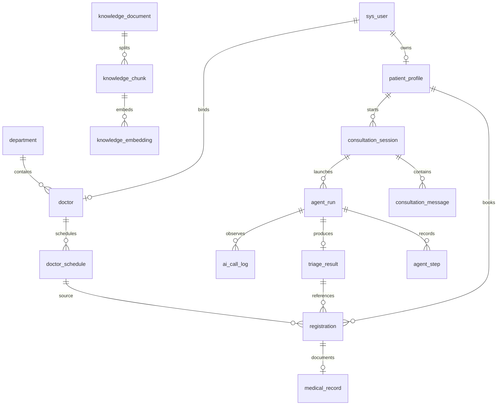

# 数据库与接口设计 · 毕设 V2

版本：V2.2 · 2026-10-11。采用MySQL业务库与PostgreSQL/pgvector向量库。

正式题目：基于检索增强生成与智能体的医院智能导诊系统设计与实现。本文与主开发文档配套，定义16表和/api接口。实际初始化DDL见[MySQL建表脚本](sql/01_mysql_schema.sql)和[PostgreSQL建表脚本](sql/02_postgresql_schema.sql)，执行约定见[SQL说明](sql/README.md)。两份脚本已在本机执行并验证基础连接，见[本地数据库初始化记录](sql/本地数据库初始化记录.md)；本文仍为应用设计规格，业务验收尚未完成。

## 1. 通用约定

业务表使用 MySQL 5.7.25+/InnoDB；向量库使用独立 PostgreSQL 16 + pgvector。两库均使用 UTF-8。业务库 BIGINT 主键，API 使用字符串 ID，避免 JavaScript 整数精度问题；业务日期 DATE，时间按各库现有约定统一 Asia/Shanghai（+08:00）。金额沿用业务库 DECIMAL(10,2)。MySQL 5.7 不执行 CHECK 约束，枚举、范围、跨字段和状态规则必须由 Service 层校验并通过真实 MySQL 集成测试验证；唯一键、外键仍由数据库执行。

实际DDL统一使用正有符号BIGINT作为主键和外键，兼容Java Long与PostgreSQL；下文早期字段表中的BIGINT UNSIGNED ID以此约定为准。号源数量仍用INT UNSIGNED。初始化主键采用AUTO_INCREMENT/PostgreSQL IDENTITY，若应用未来改用雪花ID，仍须遵守正有符号范围。

通用 created_at/updated_at；可编辑配置加 version 按需，不给所有历史表强加复杂修订机制。状态使用 VARCHAR(24) 和 Java Enum；MySQL 5.7 忽略 CHECK，因此所有业务校验由 Service 层实施。JSON 用于快照、候选和步骤摘要，常筛选字段独立列。

网站采用固定三角色 RBAC：sys_user.role 为 ADMIN、DOCTOR、PATIENT，接口权限在后端按角色检查，并校验患者本人或医生接诊关系。首版无需新增动态角色、权限和关联表。本地开发 MySQL 直接使用已有 root，PostgreSQL 使用容器初始化账号 hospital_vector_user；这两项仅是连接配置，不参与网站权限模型，不额外创建应用专用数据库账号。

MySQL库内真实关系建议 FK RESTRICT，禁止级联删除预约/病历/运行/证据；两库之间仅通过chunk_id逻辑关联，不建立跨库外键。跨库映射ID采用两库均可表示的正有符号BIGINT范围，禁止生成超出PostgreSQL BIGINT上限的ID。已有引用的知识片段不物理删；向量重建可以更换同片段的 embedding，不改引用正文。

DTO/VO 白名单，密码/Key/Prompt 私有字段不自动序列化。分页 page≥1，pageSize 1–100，默认20；白名单排序并补 id。API 日期为 YYYY-MM-DD，时间为带 +08:00 偏移的 ISO8601。

## 2. 16 张表与关系

以下共16张逻辑表：knowledge_embedding位于PostgreSQL，其余15张位于MySQL；不是两库各建16张表。Java解析切分并调用Embedding模型，PostgreSQL只负责向量保存和检索。

| 编号 | 表 | 用途 |
|---|---|---|
| 1 | sys_user | 三角色账号 |
| 2 | department | 科室目录 |
| 3 | doctor | 医生与账号绑定 |
| 4 | patient_profile | 患者档案 |
| 5 | doctor_schedule | 排班号源 |
| 6 | registration | 挂号与状态 |
| 7 | medical_record | 七段病历 |
| 8 | consultation_session | 会话、摘要、活动锁 |
| 9 | consultation_message | 对话与终态 |
| 10 | knowledge_document | 文档和任务进度 |
| 11 | knowledge_chunk | 片段与定位 |
| 12 | knowledge_embedding | 向量与空间 |
| 13 | agent_run | 导诊运行 |
| 14 | agent_step | 实际步骤 |
| 15 | triage_result | 已验证结果 |
| 16 | ai_call_log | 真实上游调用记录 |



图是逻辑关联。session.latest_result_id 是可空便利指针，历史结果按 run/session 查；建表后补外键可处理循环引用。没有独立 encounter、任务、摘要修订、工具注册或模型配置表。

## 3. 身份与基础数据

### 3.1 sys_user

| 字段 | 类型 | 说明 |
|---|---|---|
| id | BIGINT UNSIGNED | PK |
| username | VARCHAR(64) | NOT NULL，规范化，UK |
| password_hash | VARCHAR(100) | BCrypt，不返回 |
| display_name | VARCHAR(64) | 显示名 |
| role | VARCHAR(16) | PATIENT/DOCTOR/ADMIN |
| status | VARCHAR(16) | ACTIVE/DISABLED |
| created_at/updated_at | DATETIME(3) | 时间 |

索引 uk_username、(role,status,id)。公开注册固定 PATIENT，并同事务创建 patient_profile。医生开户同事务插 user 与 doctor。禁用后每个请求检查账号状态，不仅验 JWT。本版无刷新会话表；退出清客户端 Token，立即单会话撤销为扩展。

### 3.2 department

字段：id、code VARCHAR(32) UK、name VARCHAR(80)、description TEXT、location VARCHAR(120)、is_emergency TINYINT、status VARCHAR(16)、created_at/updated_at。

status=ENABLED/DISABLED。索引(status,id)。种子含真实可识别急诊科；急诊记录缺失不阻止固定急诊提示。已关联医生/未来场次不能直接删除，停用有影响校验。

### 3.3 doctor

字段：id、user_id BIGINT UK/FK、department_id BIGINT FK、name VARCHAR(64)、title VARCHAR(40)、specialty TEXT、status VARCHAR(16) ENABLED/DISABLED、created_at/updated_at。

索引(department_id,status,id)。有未来有效预约时禁止直接换所属科室；当前实现还要求先关闭未来开放排班，避免转科后旧场次与所属科室不一致。历史排班/预约不随转科迁移。禁用医生同时阻止未来新预约，历史仍可读。

### 3.4 patient_profile

字段：id、user_id BIGINT UK/FK、name VARCHAR(64)、gender VARCHAR(16) MALE/FEMALE/UNKNOWN、age INT NULL、chronic_status VARCHAR(16)、chronic_history TEXT、allergy_status VARCHAR(16)、allergy_history TEXT、created_at/updated_at。

age 0–120；两个 history 状态 UNKNOWN/NONE/KNOWN，默认 UNKNOWN。KNOWN 需正文，空值不代表“无”。预约所需姓名必须完整。本人档案行用于同患者预约串行锁。

## 4. 门诊表

### 4.1 doctor_schedule

| 字段 | 类型 | 说明 |
|---|---|---|
| id | BIGINT UNSIGNED | PK |
| doctor_id/department_id | BIGINT UNSIGNED | FK，场次身份固定 |
| visit_date | DATE | 业务日期 |
| time_slot | VARCHAR(8) | AM/PM |
| booking_deadline | DATETIME(3) | 截止时间；默认开始前30分钟 |
| total_count/remaining_count | INT UNSIGNED | >0总数、0..total余号 |
| fee | DECIMAL(10,2) | 非负 |
| status | VARCHAR(16) | OPEN/CLOSED |
| created_at/updated_at | DATETIME(3) | 时间 |

UK(doctor_id,visit_date,time_slot)，索引(department_id,visit_date,status,id)。校验 total>0、remaining≤total、fee≥0。有任何历史预约不改身份/日期/时段；总量变更锁场次行后按已占用重算。有关联 WAITING/IN_PROGRESS 时拒绝关闭。

当前本地实现按Asia/Shanghai判断业务时间，AM从08:00、PM从14:00开始，默认截止提前30分钟；自定义截止不得晚于开始。普通预约查询范围为今天到今天+6天。管理员可维护更远日期，查询范围与普通可预约范围分开。

### 4.2 registration

| 字段 | 类型 | 说明 |
|---|---|---|
| id/registration_no | BIGINT/VARCHAR(40) | PK、业务号UK |
| patient_id/schedule_id | BIGINT | FK |
| doctor_id/department_id | BIGINT | 场次所属 |
| client_request_id | VARCHAR(64) | 客户端一次操作ID |
| request_hash | CHAR(64) | 规范化请求体SHA-256 |
| triage_result_id | BIGINT NULL | 本人常规有效结果，可空 |
| visit_date/time_slot | DATE/VARCHAR(8) | 固定历史快照 |
| patient_name_snapshot | VARCHAR(64) | 挂号时姓名 |
| doctor_name_snapshot/department_name_snapshot | VARCHAR(80) | 历史名称 |
| fee_snapshot | DECIMAL(10,2) | 历史费用 |
| symptom_description | TEXT NULL | 患者确认的就诊说明 |
| status | VARCHAR(24) | WAITING/IN_PROGRESS/COMPLETED/CANCELLED |
| started_at/completed_at/cancelled_at | DATETIME(3) NULL | 状态时间 |
| cancel_reason | VARCHAR(255) NULL | 原因 |
| created_at/updated_at | DATETIME(3) | 时间 |

UK(patient_id,client_request_id)。索引(patient_id,created_at,id)、(doctor_id,visit_date,status,id)、(patient_id,visit_date,time_slot,status)、(department_id,created_at)。

同患者有效时段唯一由锁患者档案+条件检查实现，所有建单接口都必须遵循。选择另一科室时清除 triage_result_id；后端拒绝结果推荐集合之外的关联。允许同结果关联历史多次预约（例如取消后重约），不计算转化率。

### 4.3 medical_record

字段：id、registration_id BIGINT UK/FK、doctor_id BIGINT、chief_complaint TEXT、present_illness TEXT、past_history TEXT、physical_exam TEXT、auxiliary_exam TEXT、preliminary_diagnosis TEXT、treatment_plan TEXT、status VARCHAR(16)、version INT、submitted_at DATETIME(3) NULL、created_at/updated_at。

DRAFT/SUBMITTED，正文必填限制按七段设置，每段最大约10,000字起步。未检查可写明说明。草稿保存带 doctor_id、DRAFT、version 条件；版本冲突409。提交和 registration COMPLETED 同事务，正文不可解锁更新。仅本人患者可读SUBMITTED，不允许管理员通用病历编辑。

## 5. 会话与消息

### 5.1 consultation_session

| 字段 | 类型 | 说明 |
|---|---|---|
| id/patient_id | BIGINT | PK/FK |
| title | VARCHAR(100) | 会话摘要标题 |
| summary_json | JSON NULL | 主诉/时长/程度/伴随/否认/确认风险回答 |
| summary_version | INT | 每次变更增加 |
| summary_confirmed_at | DATETIME(3) NULL | 患者确认 |
| summary_source_message_id | BIGINT NULL | 摘要参考截至消息 |
| latest_result_id | BIGINT NULL | 当前有效结果指针 |
| active_operation_id | VARCHAR(64) NULL | 当前CHAT或TRIAGE所有权 |
| active_operation_type | VARCHAR(16) NULL | CHAT/TRIAGE |
| operation_deadline | DATETIME(3) NULL | 超时恢复 |
| deleted_at | DATETIME(3) NULL | 逻辑删除 |
| created_at/updated_at | DATETIME(3) | 时间 |

索引(patient_id,deleted_at,updated_at,id)。原子条件更新取得活动锁；完成时 WHERE active_operation_id=:ownedId 释放。超时恢复先把关联消息/run 终结再释放；旧回调条件失败不得改当前状态。

新用户消息撤销 summary_confirmed_at 和 latest_result_id，增加摘要失效标识（通过确认空值表达）；旧run/result保留。摘要 PUT带expectedSummaryVersion。活动中不允许编辑、删除或再次创建任务。

### 5.2 consultation_message

字段：id、session_id BIGINT FK、role VARCHAR(16) USER/ASSISTANT、client_message_id VARCHAR(64)、request_id VARCHAR(64)、content MEDIUMTEXT、status VARCHAR(16)、error_code VARCHAR(64) NULL、created_at/updated_at。

USER状态COMPLETED；ASSISTANT状态STREAMING/COMPLETED/FAILED/CANCELLED。UK(session_id,role,client_message_id)，索引(session_id,id)、(request_id)。

一个客户端操作用相同clientMessageId生成user和assistant两条记录。SSE增量分批写assistant，终态写最终正文。重复提交相同ID只返回已存在状态或409/JSON data，不再开第二次生成；前端通过GET恢复。失败后显式新ID重试，保留旧失败记录。

## 6. 知识表与简化后台任务

### 6.1 knowledge_document

| 字段 | 类型 | 说明 |
|---|---|---|
| id/title | BIGINT/VARCHAR(200) | 主键与标题 |
| file_key/file_sha256 | VARCHAR(255)/CHAR(64) | 私有存储键/摘要 |
| mime_type/file_size | VARCHAR(100)/BIGINT | 类型/大小 |
| source_description | VARCHAR(1000) | 来源/版本说明必填 |
| document_version | VARCHAR(100) | 资料版本 |
| enabled | TINYINT | 是否可用 |
| status | VARCHAR(24) | QUEUED/PARSING/CHUNKING/EMBEDDING/READY/FAILED |
| task_kind | VARCHAR(16) | INGEST 普通入库 / REBUILD 全量重建 |
| target_space_key | VARCHAR(128) NULL | 任务目标空间 |
| task_operation_id | VARCHAR(64) NULL | 工作线程所有权 |
| task_deadline | DATETIME(3) NULL | 任务超时 |
| total_chunks/embedded_chunks | INT | 进度 |
| attempt_no | INT | 重试序号 |
| error_code/error_message | VARCHAR(64)/VARCHAR(1000) NULL | 脱敏原因 |
| uploaded_by | BIGINT | 管理员 |
| created_at/updated_at | DATETIME(3) | 时间 |

UK(file_sha256,document_version)，索引(enabled,status,id)。不增加任务表；一文档一活动任务。重复文件返回已有记录或提示换资料版本。源文档/已被引用片段不可物理删除，停用即可。

简单文档池并发1；启动将未完成任务标FAILED，管理员重试。任务ID条件写入防止旧线程覆盖新任务。解析/切分失败可重做，已有chunk重新Embedding时按唯一键重试，不重复插。

全量维护锁由单机知识服务管理。普通上传标记task_kind=INGEST，仅检索当前空间中已READY的启用文档；新文档排队或失败不影响已有可用知识。全量重建在覆盖任何向量前，将全部目标文档持久化标记为task_kind=REBUILD、status=QUEUED及统一target_space_key；全部目标文档READY且向量空间一致后才开放检索，失败保持维护状态。重启按REBUILD标记与目标空间恢复维护状态，不能把普通INGEST失败误判成全局维护。重建任务不能与上传/启停并发；接口409返回维护状态。任务超时建议每文档10分钟，可按片段数调整；不用于无限等待。

### 6.2 knowledge_chunk

字段：id、document_id BIGINT FK、chunk_no INT、split_version VARCHAR(40)、content MEDIUMTEXT、content_sha256 CHAR(64)、title_path VARCHAR(500) NULL、page_start/page_end INT NULL、paragraph_start/paragraph_end INT NULL、char_count INT、created_at。

UK(document_id,split_version,chunk_no)，索引(document_id,id)。首次切分保存真实页码或段落。正文/定位一旦被引用不原地改；修改源资料上传新document。换Embedding不必重切旧正文。chunk无单独enabled，跟随document。

### 6.3 knowledge_embedding

PostgreSQL 向量库字段：id BIGINT主键、chunk_id BIGINT NOT NULL UNIQUE、space_key VARCHAR(128)、dimension INT、embedding vector、vector_norm DOUBLE PRECISION、status VARCHAR(16) READY/FAILED、error_code VARCHAR(64) NULL、created_at/updated_at TIMESTAMPTZ。chunk_id对应MySQL知识片段ID，由应用维护映射；两库之间不建立跨库外键。维度使用应用校验和CHECK(vector_dims(embedding)=dimension)约束，向量必须有限且非零范数。首版使用不固定维度的vector列，以便维护重建时更新维度；查询先过滤当前spaceKey和dimension，不混空间计算。

本版每chunk只有当前向量，换空间维护时覆盖/重建，引用指向不变的chunk。普通字段索引为(space_key,status,chunk_id)，chunk_id唯一约束用于ON CONFLICT幂等更新；模型实现及归一化版本编码在spaceKey中，不另建模型配置表。首版使用pgvector精确余弦距离排序，不要求向量索引。后续选做HNSW/IVFFlat时，先核对已安装pgvector版本的维度上限，再为目标空间创建固定维度的表达式/部分索引，查询使用相同转换与过滤条件；模型维度改变后重新评估并重建索引。

检索资格由MySQL确定，PostgreSQL不直接访问MySQL的document表。首版不冗余同步document.enabled，而是按以下流程检索：

1. 在单机知识闸门读锁内，从MySQL查询 enabled=1、status=READY、target_space_key=当前空间的文档及其chunkId集合；空集合返回UNAVAILABLE，不发送无过滤的向量查询。
2. 向PostgreSQL传入候选ID数组、当前spaceKey、dimension、查询向量和TopK，先过滤候选再排序。总片段数上限约5,000，数组使用参数绑定，不拼接SQL。
3. 按命中chunkId批量回MySQL取正文、来源和实际页/段落，按向量排名组装结果；回查完成释放读锁。若向量数量或映射异常，报告知识一致性错误，不伪造引用或静默补齐。

```sql
-- PostgreSQL参数化查询示意；参数由向量仓库绑定。
SELECT chunk_id, 1 - (embedding <=> CAST(:queryVector AS vector)) AS score
FROM knowledge_embedding
WHERE chunk_id = ANY(CAST(:candidateIds AS bigint[]))
  AND space_key = :spaceKey AND dimension = :dimension AND status = 'READY'
ORDER BY embedding <=> CAST(:queryVector AS vector), chunk_id
LIMIT :topK;
```

TopK≤10（患者工具≤5），阈值用开发集调，score为1减余弦距离，不作为医学概率。不能在全库LIMIT后才排除禁用文档；禁用片段不能挤占有效候选的TopK。文档启停、READY发布和维护切换取得同一闸门写锁；模型调用和解析不持锁。运行已取得的引用快照按原运行保存，后续启停不篡改历史证据。

### 6.4 双库入库、重试与故障

MySQL短事务创建/领取任务并保存片段，提交后调用Embedding；每批向量用PostgreSQL短事务按chunk_id UPSERT。最终逐片段校验PostgreSQL中当前空间/维度/READY向量与MySQL片段完全对应，完成后在知识写锁内以task_operation_id条件更新MySQL文档READY及进度。仅计数相等不能代替ID对应和向量有效性检查。

任一阶段失败保留MySQL文档FAILED和脱敏错误，未完成文档不参加检索。部分已提交向量可保留，重试复用相同chunkId并补齐缺失/不合格向量；PostgreSQL提交成功而MySQL发布失败时，重试重新校验并发布，不重复切分。全量重建仍按维护规则执行，失败不解除维护，不引入分布式事务或新增任务表。

单机同文档的PostgreSQL写入和任务领取/重试使用同一互斥保护：每批写入前检查MySQL当前task_operation_id及deadline，写入期间不得为该文档领取新任务；终态后旧Embedding回调不能写向量或进度。互斥范围仅为短数据库操作，不包含外部模型调用。重启终结旧任务后才能重试。单机约束之外的多实例任务协调不属于本版。

PostgreSQL不可用时，普通RAG导诊/检索测试明确失败或不可用，不能退回伪造知识；MySQL门诊功能仍可用。服务启动独立检查两库健康，向量库故障不能成为基础门诊启动的强制依赖。两个DataSource/事务管理器显式区分，MySQL业务事务不包含PostgreSQL提交或外部模型请求。

## 7. 智能体与结果

### 7.1 agent_run

| 字段 | 类型 | 说明 |
|---|---|---|
| id/run_no | BIGINT/VARCHAR(40) | PK/UK |
| patient_id/session_id | BIGINT | 归属 |
| client_request_id/request_hash | VARCHAR(64)/CHAR(64) | 幂等与请求绑定 |
| summary_version/input_snapshot | INT/JSON | 确认症状、档案、消息范围 |
| model_name/config_fingerprint/prompt_hash | VARCHAR(100)/CHAR(64)/CHAR(64) | 排除Key，复现参数 |
| tool_names/knowledge_snapshot | JSON | 固定规格与可用文档空间信息 |
| safety_rule_version | VARCHAR(40) | 确认问题规则版本 |
| status | VARCHAR(16) | QUEUED/RUNNING/SUCCEEDED/DEGRADED/FAILED/CANCELLED |
| max_rounds/max_tool_calls | INT | 4/6起步 |
| actual_rounds/actual_tool_calls | INT | 实际 |
| deadline_at/started_at/finished_at | DATETIME(3) | 时限 |
| error_code/error_message | VARCHAR(64)/VARCHAR(500) NULL | 失败 |
| trace_id | VARCHAR(64) | 关联 |
| created_at/updated_at | DATETIME(3) | 时间 |

UK(patient_id,client_request_id)，索引(session_id,created_at,id)、(status,deadline_at)、(trace_id)。结果按run_id查，不另加循环result_id。

开始前短事务锁session并插run，再提交到有界执行器。队列拒绝时run标FAILED、条件释放锁，返回503。总deadline从接受开始计算。重启时旧RUNNING/超期QUEUED失败，不自动重跑付费模型调用。

### 7.2 agent_step

字段：id、run_id BIGINT FK、sequence_no INT、round_no INT、step_type VARCHAR(24) MODEL/TOOL/SAFETY/VALIDATION/FINAL、tool_name VARCHAR(100) NULL、tool_call_id VARCHAR(100) NULL、status VARCHAR(16) RUNNING/SUCCEEDED/FAILED/TIMEOUT、input_redacted JSON NULL、output_summary JSON NULL、evidence_chunk_ids JSON NULL、public_label VARCHAR(200)、started_at/finished_at、duration_ms BIGINT NULL、error_code VARCHAR(64) NULL、created_at。

UK(run_id,sequence_no)，索引(run_id,sequence_no)。每个实际tool_call单独一步，拒绝执行也记录原因。患者API只返回公开标签/状态/耗时，管理员看脱敏结构；不增加隐藏思维链字段。

### 7.3 triage_result

字段：id、run_id BIGINT UK/FK、patient_id BIGINT、session_id BIGINT、summary_version INT、department_id BIGINT NULL、alternative_department_ids JSON、risk_level VARCHAR(16) ROUTINE/ATTENTION/EMERGENCY、validation_status VARCHAR(24) VALID/LIMITED/NEED_MORE_INFO、reason TEXT、evidence_refs JSON、doctor_options_snapshot JSON、missing_information JSON、expires_at DATETIME(3)、created_at。

索引(patient_id,created_at,id)、(department_id,created_at)。没有模型自评分字段。result快照不可原地重写；slot列表仅作结果时快照，确认页重查。默认expires=24h仅作工程入口有效期，症状变化要重问，不是医学有效期。

SUCCEEDED通常配VALID结果；DEGRADED允许LIMITED/NEED_MORE_INFO结果；FAILED/CANCELLED无有效结果。强制明确急诊引导可SUCCEEDED/VALID、department为真实急诊或NULL且固定提示，拒绝普通预约关联。

### 7.4 ai_call_log

字段：id、trace_id VARCHAR(64)、request_id VARCHAR(64)、run_id/step_id/message_id/document_id BIGINT NULL、purpose VARCHAR(24) PRECONSULT/AGENT/EMBED_DOCUMENT/EMBED_QUERY、model_name VARCHAR(100)、config_fingerprint CHAR(64)、status VARCHAR(16) RUNNING/SUCCEEDED/FAILED/TIMEOUT/CANCELLED、input_tokens/output_tokens/total_tokens BIGINT NULL、usage_source VARCHAR(16) PROVIDER/UNAVAILABLE、started_at/finished_at、duration_ms BIGINT NULL、first_token_latency_ms BIGINT NULL、error_code VARCHAR(64) NULL、error_message VARCHAR(500) NULL、created_at。

索引(started_at,purpose)、(run_id,step_id)、(trace_id)。一次真实上游调用一条（Agent每轮和RAG查询Embedding分别记）。usage缺失为NULL；无自动估算/成本平台。取消后不冒充成功；终态仅写一次。

## 8. 三个工具契约

| 工具 | JSON入参 | 必须校验 | 输出 |
|---|---|---|---|
| searchMedicalKnowledge | query:string、topK:int默认5 | 非空≤1000字、1..5、索引READY、当前空间 | hits:[chunkId,title,location,excerpt,score]、spaceKey |
| findDepartments | keyword:string可空 | ≤100字，只启用 | departments:[id,code,name,description] |
| findAvailableSchedules | departmentId:string、startDate/endDate | 真实科室、今天起七天、范围≤7天 | options:[scheduleId,doctorId,doctorName,date,slot,remaining,fee,deadline] |

三个工具是代码注册的只读服务。不接任意URL/SQL，不允许模型提供patientId。RAG超时包含查询Embedding；其他查询超时不超过3秒。

候选JSON：
```json
{
  "departmentId": "3",
  "reason": "根据已确认的信息建议咨询该科室。",
  "evidenceChunkIds": ["77"],
  "needMoreInfo": false,
  "questions": []
}
```

这是格式示例，不是医学结论。后端验证departmentId启用、引用属于本run检索结果；schedule来自独立最终查询。未经检索或引用不足返回降级，不能算完整成功。

## 9. REST公共契约

统一前缀 /api，JWT Authorization Bearer。ID字符串，不把请求patientId/fee当可信数据。

```json
{
  "code": "OK",
  "message": "成功",
  "data": {"id": "10001"},
  "traceId": "trace-001"
}
```

分页data：items、total、page、pageSize。错误保持同信封，HTTP400参数/401未登录/403权限/404资源不可见/409状态冲突/422确认信息缺失/429并发频率/503AI索引不可用/500异常。201创建，202后台接受。SSE开始前也遵循JSON错误，开始后发error并关闭。

错误码建议：ACCOUNT_DISABLED、RESOURCE_NOT_FOUND、SCHEDULE_FULL、SCHEDULE_CLOSED、BOOKING_EXPIRED、DUPLICATE_ACTIVE_SLOT、REQUEST_ID_CONFLICT、RECORD_VERSION_CONFLICT、SESSION_BUSY、SUMMARY_NOT_CONFIRMED、KNOWLEDGE_MAINTENANCE、EMBED_SPACE_MISMATCH、AI_AUTH_FAILED、AI_TIMEOUT、AGENT_BUDGET_EXCEEDED、AI_OUTPUT_INVALID。

## 10. 登录与患者API

| 方法 | 路径 | 契约 |
|---|---|---|
| POST | /auth/register | username/password/displayName；固定PATIENT |
| POST | /auth/login | 返回token/expiresIn/user；错误不泄露密码 |
| GET | /auth/me | 角色和本人doctorId/patientId |
| GET/PUT | /patient/profile | 本人档案 |
| GET | /departments | 启用公开科室 |
| GET | /schedules | departmentId/doctorId/date；未来七天有效场次 |
| GET | /schedules/{id} | 实时余号、费用和截止 |
| POST/GET | /patient/consultations | 创建/分页自己的会话 |
| GET/DELETE | /patient/consultations/{id} | 消息分页/逻辑删；活动中409 |
| PUT | /patient/consultations/{id}/summary | expectedSummaryVersion、summary、confirm=true |
| POST | /patient/consultations/{id}/messages/stream | clientMessageId/content；校验后SSE |
| GET | /patient/messages/{id} | 本人消息终态和完整/部分正文 |
| POST | /patient/messages/{id}/cancel | 取消活跃assistant请求，幂等 |
| POST | /patient/triage-runs | sessionId/summaryVersion/clientRequestId；202 |
| GET | /patient/triage-runs/{id} | 状态、公开steps、resultId；afterSequence可选 |
| POST | /patient/triage-runs/{id}/cancel | 协作取消未结束run |
| GET | /patient/triage-results/{id} | 本人已验证结果 |
| POST/GET | /patient/registrations | 创建/本人分页 |
| GET | /patient/registrations/{id} | 本人快照/状态 |
| POST | /patient/registrations/{id}/cancel | 原因；截止前WAITING |
| GET | /patient/registrations/{id}/medical-record | 本人SUBMITTED |

注销仅客户端清Token，不假称支持服务端单JWT撤销。修改密码若增加接口需要令旧Token失效策略另行设计；不在基线强加。

### 10.1 摘要确认

```json
{
  "expectedSummaryVersion": 2,
  "confirm": true,
  "summary": {
    "chiefComplaint": "虚构症状描述",
    "duration": "三天",
    "severity": "患者自述程度",
    "associatedSymptoms": [],
    "pertinentNegatives": [],
    "riskAnswers": {"rule-a": "UNKNOWN"}
  }
}
```

风险YES/NO/UNKNOWN，不能缺省为NO。输入改变创建新summaryVersion，版本冲突409。已确认但有新消息需再次确认。

### 10.2 创建导诊与轮询

```json
{
  "sessionId": "801",
  "summaryVersion": 3,
  "clientRequestId": "triage-client-uuid"
}
```

请求哈希绑定session/version；同clientRequestId返回同run，相异body返回409。成功202 data含runId/status/pollAfterMs=2000。开始前检查索引可用，维护中503。run轮询只暴露本人公开步骤；终态停止。

### 10.3 预约

```json
{
  "scheduleId": "501",
  "clientRequestId": "registration-client-uuid",
  "triageResultId": "901",
  "symptomDescription": "患者确认的就诊症状"
}
```

triageResultId可空；有值需本人、有效期内、未失效摘要版本、常规可预约、场次科室属于已验证推荐。改选其他科室清除关联。姓名、医生、fee/date由后端取真实场次快照。状态/余号变化409，不自动换场次。

## 11. SSE网络契约

成功200 Content-Type:text/event-stream，Cache-Control:no-cache，X-Accel-Buffering:no。每15秒注释心跳。客户端TextDecoder streaming +空行拼接，不按网络包直接JSON.parse。

```text
event: meta
data: {"requestId":"req-001","messageId":"102","seq":0}

event: delta
data: {"requestId":"req-001","messageId":"102","seq":1,"text":"请补充症状持续时间。"}

event: done
data: {"requestId":"req-001","messageId":"102","seq":2,"status":"COMPLETED"}

```

流内错误event:error含code/message/messageId/seq，终结为FAILED；用户停止CANCELLED。这里seq是本次流序号，不提供Last-Event-ID重放；断线GET message。重复clientMessageId请求返回409 JSON带现有messageId/status，引导查询，不能默默重调用模型。

Nginx /api location关闭proxy_buffering/cache，proxy_read_timeout180s，应用流120s，禁用会造成攒包的压缩。SSE抓包与直接API都要验证。

## 12. 医生API

| 方法 | 路径 | 契约 |
|---|---|---|
| GET | /doctor/registrations | date/status/page；仅本人名下 |
| GET | /doctor/registrations/{id} | 本人患者档案、症状和预约 |
| POST | /doctor/registrations/{id}/start | WAITING→IN_PROGRESS，重复返回已有状态 |
| GET | /doctor/registrations/{id}/medical-record | 草稿或提交正文 |
| PUT | /doctor/registrations/{id}/medical-record | 七段+version；DRAFT条件保存 |
| POST | /doctor/registrations/{id}/complete | 草稿version，提交正文与完成同事务 |
| GET | /doctor/schedules | 本人日期范围 |

首次草稿可由start创建，初始version=0；PUT已有草稿成功version+1。complete需当前version及七段合法；重复complete返回完成记录，不解锁。病历草稿对患者不可见。

## 13. 管理API

| 方法 | 路径 | 契约 |
|---|---|---|
| GET | /admin/users | 账号分页 |
| PUT/PATCH | /admin/users/{id}/status | ACTIVE/DISABLED，立即影响旧Token |
| GET/POST | /admin/departments | 查询/创建 |
| PUT | /admin/departments/{id} | 校验影响，不删历史 |
| GET/POST | /admin/doctors | 查询/创建并开户 |
| PUT | /admin/doctors/{id} | 转科有预约时拒绝 |
| GET/POST | /admin/schedules | 查询/创建 |
| PUT | /admin/schedules/{id} | 总量重算，身份/历史日期限制 |
| POST | /admin/schedules/{id}/close | 存活动预约409 |
| POST | /admin/knowledge/documents | multipart文件/title/source/version；202+documentId |
| GET | /admin/knowledge/documents | 处理进度、enabled、错误 |
| GET | /admin/knowledge/documents/{id} | 任务状态/片段数/空间 |
| GET | /admin/knowledge/documents/{id}/chunks | 定位与正文分页 |
| PATCH | /admin/knowledge/documents/{id}/enabled | 影响新检索；维护中409 |
| POST | /admin/knowledge/documents/{id}/retry | 失败项重试，活动任务409 |
| GET | /admin/knowledge/status | 全局AVAILABLE/MAINTENANCE/UNAVAILABLE、当前空间 |
| POST | /admin/knowledge/rebuild | 全量启用文档，202；有活跃导诊先拒绝或管理员取消 |
| POST | /admin/knowledge/search | query/topK≤10；hits/score/位置/耗时 |
| GET | /admin/agent-tools | 三工具只读名称/说明/Schema；无注册开关 |
| GET | /admin/agent-runs | 日期/状态/trace筛选 |
| GET | /admin/agent-runs/{id} | 脱敏快照、步骤、结果、预算 |
| GET | /admin/ai-call-logs | 用途/状态/日期分页 |
| GET | /admin/ai-call-logs/{id} | 脱敏错误、模型与关联 |
| GET | /admin/statistics | 基本统计及趋势/科室分布 |

无模型配置、Prompt管理、动态工具注册接口。固定工具页是说明/运行跳转，不冒充实现了MCP。上传目录不能公开列出，患者只从结果取授权引用摘录。

## 14. 核心事务与任务伪代码

### 14.1 预约/取消

```text
预约 BEGIN
  SELECT 本人patient_profile FOR UPDATE
  先查clientRequestId：已有则hash相同返回同挂号，否则409
  查本人同日同slot WAITING/IN_PROGRESS：有则409
  验证科室/医生启用、场次、可选triage归属及有效性
  条件UPDATE扣减场次，影响行数必须=1
  插registration与历史快照
COMMIT；任一步失败ROLLBACK

取消 BEGIN
  按患者档案→场次→挂号顺序锁行
  查本人、截止、WAITING
  若已CANCELLED返回，不返号
  条件更新CANCELLED成功后，原场次remaining+1
COMMIT
```

医生start和cancel在registration行状态竞争；只有一个成功。cancel先锁场次，不让已IN_PROGRESS返号。独立患者同最后一号靠UPDATE行锁/条件保证。死锁若发生最多一次可幂等重试并记录，不能无限循环。

### 14.2 Agent领取/终结

```text
BEGIN 锁session；验证摘要版本、确认、无活动任务
  查询run幂等；创建QUEUED +输入快照
  session活动ID=run对应请求，type=TRIAGE，deadline=接受+60秒
COMMIT
提交有界工作池，拒绝则FAILED并条件释放
RUNNING：每轮执行前检查status/deadline/预算
终结BEGIN 锁run/session，确认仍拥有且未终态
  插已校验result（若有），更新run状态/finishedAt
  session.latestResultId更新并按operationId释放
COMMIT
```

取消/超时先终结；旧回调检查失败不落成功结果。没有结果的失败也释放会话。restart终结旧活动请求，不让用户永远SESSION_BUSY。

### 14.3 文档处理/重建

短事务插文档QUEUED，单机受限线程领取操作ID后解析/调用Embedding，外部耗时不占数据库事务。按chunk唯一键入库；用当前任务ID条件更新进度与READY。全量重建先维护锁，禁止新RAG导诊/知识写操作，已有run结束后清/覆盖目标向量，全部一致READY后开放。失败维持UNAVAILABLE并显示失败文档。

## 15. 种子、索引与迁移

建议种子：1管理员、3医生、10患者、6–8科室含急诊、七天20–40场次、10–20份可使用文档。日期按当前业务日生成；账号密码由开发环境提供，不提交实际模型Key或生产数据。

已提供两份首次空库初始化SQL，MySQL15表、PostgreSQL1表，循环外键最后添加。MySQL脚本保留 CHECK 声明供阅读及升级到支持约束的版本时使用，但 MySQL 5.7 不执行这些约束；对应规则由 Service 层及真实数据库集成测试保障。它们不是Flyway分版本迁移；后续迁移可分V1身份基础、V2门诊、V3问诊Agent、V4知识日志。唯一键和外键仍须在实际数据库验证，不能将静态核验当作执行成功。

EXPLAIN检查：本人预约、医生当日队列、七天科室场次、会话消息、文档READY筛选、向量相似度查询、运行步骤与日志。局部分页与复杂join不交叉保留分页线程状态；若使用MyBatis-Plus，分页插件只用于明确的单次查询，不能在异步任务、SSE或跨库调用中依赖线程上下文。

实现后输出OpenAPI（含SSE说明），对照本表验证ID字符串、状态、错误、可空Token、摘要锁与日期。不要求本次文档就连接 MySQL/PostgreSQL 运行。
