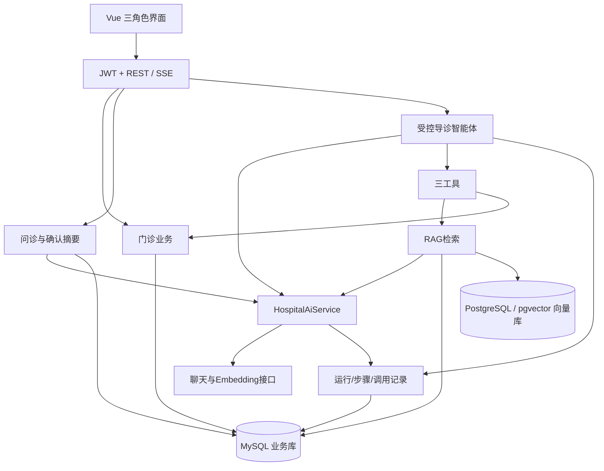

# 基于检索增强生成与智能体的医院智能导诊系统设计与实现

| 项目项 | 内容 |
|---|---|
| 文档版本 | V2.2 · 2026-10-11 |
| 项目定位 | 个人毕业设计，单医院、三角色 Web 系统 |
| 核心技术 | Spring Boot、LangChain4j、RAG、工具调用智能体、SSE、MySQL + PostgreSQL/pgvector、Vue 3 |
| 设计规模 | 17 张逻辑表（含 AI 凭据）、3 个固定只读工具、20 类页面（含管理员 AI 配置） |
| 开发周期 | 有 Java/Vue 基础且每周约25小时，12周为紧凑计划；边学边做预留14–16周 |
| 当前状态 | 目标规格；2026-10-13三端普通门诊、SSE问诊、知识库、摘要确认、固定工具/受控Agent、运行记录与统计已有首版，后端57项及前端8项测试通过；2026-10-14维护重建/会话删除/历史恢复已实现并通过后端77项回归；完整真实模型联调、空间切换/故障专项及性能效果尚待验收，见[开发进度](../docs/开发进度.md) |
| 参考材料 | 用户题目与功能说明；此前逐张审阅的本地11张原型 |

配套：[页面与交互设计](页面与交互设计.md)、[数据库与接口设计](数据库与接口设计.md)、[验收与答辩方案](验收与答辩方案.md)。正式规格为这四份正文和[README](README.md)，以本版为开发依据；[SQL目录](sql/README.md)提供两库首次初始化文件。

## 1. 项目目标与技术贡献

患者描述症状，通过多轮问诊补充信息并确认摘要。导诊智能体根据症状自主选择知识检索、科室查询和排班查询工具，结合真实证据形成科室建议。后端核验科室与号源后，患者自主预约，医生接诊并提交电子病历。

毕业设计的技术重点：

1. **RAG**：文档解析、切分、Embedding、向量检索、结合片段生成建议并展示真实来源。
2. **智能体**：模型选择工具，读取工具结果，再决定继续调用或输出；代码控制轮数、权限与总时间。
3. **业务一致性**：真实数据校验、短事务扣号、重复请求处理、病历提交锁定。

使用框架本身不称算法创新。论文通过检索和病例实验说明设计的效果与局限，科室建议用于导诊参考，不声称实现临床诊断或治疗决策。

## 2. 范围与工作量控制

| 模块 | 必须完成 | 选做 |
|---|---|---|
| 门诊业务 | 登录/档案/科室/医生/排班/预约/取消/接诊/七段病历 | 病历打印、排班批量新增 |
| 预问诊 | 多轮对话、真实SSE、历史、取消/断流提示、摘要确认 | 自动总结、长对话压缩 |
| RAG | TXT/文本型PDF、切分、Embedding、向量TopK、来源定位 | DOCX、重排、混合检索 |
| 智能体 | 三工具、自主调用、循环预算、超时、结果校验、时间线 | 更多只读工具 |
| 管理 | 文档进度、失败重试、检索测试、运行详情、调用日志 | 更细统计筛选 |
| 实验 | A/B/C对比、检索命中、科室一致、引用支持、场次有效性 | MRR、参数消融 |

单医院；一患者账号一份档案，一医生账号绑定一医生；上午/下午排班。挂号费只展示，不接支付、医保、处方和HIS。

模型端点与模型名由环境变量/配置绑定，API Key 由管理员保存到 MySQL，启动时可从环境变量导入空记录，Prompt在后端资源文件，修改后重启。不做数据库动态MCP、远程MCP协议、复杂Prompt发布、多智能体、微服务或分布式任务。题目含RAG与智能体，两项均须真实实现，不能替换为关键词匹配或固定流水线。

上一级“完整版”是扩展参考，其33张表和治理平台不属于本版工作量。

## 3. 原型映射与角色权限

| 原图 | 本版页面与调整 |
|---|---|
| 1.png | 登录/患者注册，补可见标签与错误 |
| 2.png | 患者首页与最近预约 |
| 3.png | SSE问诊、摘要确认、实际执行状态与独立结果 |
| 4.png | 科室/日期/医生场次及预约确认 |
| 5.png | 本人就诊与七段病历阅读 |
| 6.png | 管理首页和基础导航 |
| 7.png | 排班CRUD/关闭，移除历史顺延重置 |
| 8.png | 文档片段、向量状态和检索测试 |
| 9.png | 挂号趋势/科室分布，去掉医学命中率 |
| 10.png | 简单AI调用日志 |
| 11.png | 固定工具说明与运行详情，无动态开关 |

医生工作台、病历编辑、文档任务、摘要确认等为新增设计，页面细节见配套文件。

| 能力 | 患者 | 医生 | 管理员 |
|---|---|---|---|
| 档案/问诊 | 本人读写 | 本人接诊患者的相关信息只读 | 默认管理账号；排障仅脱敏 |
| 预约 | 本人创建与条件取消 | 本人名下查看/接诊 | 管理排班、看基础统计 |
| 病历 | 本人SUBMITTED | 本人接诊的草稿/提交 | 无正文编辑接口 |
| 知识/运行 | 本人结果及授权摘录 | 关联症状信息 | 上传、测试检索、脱敏回放 |

身份来自JWT，不信任请求patientId/doctorId；Service层检查角色与资源归属。公开注册固定PATIENT。密码BCrypt、禁用账号拒绝旧Token。JWT建议2小时，过期重新登录，不增加刷新会话表；退出清客户端Token，本版不宣称服务端撤销单次JWT。前端纯文本显示模型回答，API Key不进仓库、浏览器或日志。

## 4. 技术栈与能力验证

| 层 | 推荐 | 要求 |
|---|---|---|
| Java/构建 | JDK21、Maven3.9.x，最低3.8+ | 编译release=21，锁定具体版本 |
| 框架 | Spring Boot3.5.x、Spring MVC | SseEmitter、有界后台池 |
| AI | LangChain4j普通OpenAI依赖 | 模型工厂集中建对象，不使用模型自动注入starter |
| 数据 | MySQL 5.7（业务数据）+ PostgreSQL 16/pgvector（向量数据）、MyBatis-Plus | 业务事务在 MySQL 内完成；向量检索使用 pgvector；复杂查询和跨库查询使用显式 SQL |
| 校验/认证 | Bean Validation、Java JWT、BCrypt | DTO校验与资源权限 |
| 解析 | PDFBox、UTF-8 TXT | 保留实际页/段落；扫描件暂不OCR |
| 前端 | Vue3、Vite6.x、Element Plus、Vue Router、Axios | JavaScript即可；Fetch读取POST SSE |
| 环境 | Node.js22 LTS | 与锁定Vite补丁兼容 |
| 图表/测试 | ECharts、JUnit5、实际MySQL和PostgreSQL | 业务并发、权限、流式、精确向量检索和跨库重试重点验证 |

这些是版本系列建议，具体补丁必须第一周验证后锁定。分别验证普通chat、stream、Embedding、tool calling，不能因chat成功就声称供应商完全兼容。

2026-10-13后端已锁定Java21、Spring Boot3.5.13、MyBatis-Plus3.5.15、LangChain4j1.0.1、Connector/J8.0.33与PostgreSQL驱动42.7.7；本机MySQL5.7.25、PostgreSQL16.15/pgvector0.8.6已完成集成测试。用户指定百炼工作空间的qwen-plus与text-embedding-v4（1024维）已分别通过四能力真实请求验证；这不代表完整业务Agent或医学效果已完成验收。前端已锁定Vue3.5.22、Vite6.3.6、Element Plus2.11.4、Vue Router4.5.1与Axios1.12.2，并通过构建。

LangChain4j负责模型协议与工具规格；应用层负责受控循环。若SDK默认工具执行不能满足预算/超时，使用其低层模型接口手工编排tool_calls，不在Prompt里假设限制已经生效。

## 5. 总体架构与模块



后端模块：common、auth、masterdata、schedule、registration、record、consultation、knowledge、agent、ai、statistics。模块内按Controller/Service/Mapper/DTO/VO组织。

前端patient/doctor/admin三个layout，共用SSE客户端、证据卡、状态和表格。不把全部页面状态塞全局store。

外部模型请求不占数据库长事务；日志与业务落库分短事务。异步身份、requestId、runId、traceId显式传递，不依赖请求ThreadLocal。

## 6. 普通门诊与关键事务

预约WAITING→IN_PROGRESS→COMPLETED；截止前WAITING可CANCELLED。患者只取消本人预约，医生只接诊自己名下患者。

一次预约锁患者档案→先查clientRequestId/hash→检查同日同slot有效预约→校验场次→条件扣号→插挂号快照，全部同事务。UK(patientId,clientRequestId)兜底重复提交，同键不同内容409。不同患者抢最后一号靠数据库条件更新保证仅一成功。

```sql
UPDATE doctor_schedule
SET remaining_count = remaining_count - 1
WHERE id = :scheduleId
  AND status = 'OPEN'
  AND remaining_count > 0
  AND booking_deadline > CURRENT_TIMESTAMP(3);
```

取消先查归属和已取消终态，再按患者→场次→挂号锁行检查WAITING/截止，首次取消成功才返1号。重试不重复返号；start与cancel靠挂号状态竞争。

排班产生历史预约后不改身份/日期/时段，修改total按已占用重算；有WAITING/IN_PROGRESS不关闭。费用、科室/医生名和就诊日期在挂号时快照。

病历七段：主诉、现病史、既往史、体格检查、辅助检查、初步诊断、处理意见。手动保存DRAFT携带version，SUBMITTED正文只读。提交病历与挂号COMPLETED同事务；未检查明确写说明，不默认正常。

## 7. 多轮问诊、SSE与摘要

上下文初始使用最近10条有效消息和档案，每条用户≤1,000字，每轮最多2–3个补问。年龄/慢病/过敏的“未知”与“无”区分。超过窗口提示复制摘要新开会话；长历史压缩为选做。

Axios做REST；Fetch + ReadableStream做携带Authorization的POST SSE，JWT不放URL。事件meta/delta/error/done包含requestId/messageId/seq；TextDecoder流式解码并按空行拼完整事件，处理半包/CRLF/多行data。delta来自真实模型回调，不做前端逐字模拟。

登录/归属/长度/活动操作检查在打开SSE前返回JSON错误。接受后保存user和assistant占位，增量分批写库，终态写完整或已保存的部分文字。同clientMessageId复用查询已有消息，不再次付费生成；显式失败重试用新ID。

停止：前端AbortController和取消API，后端标CANCELLED并尽力取消上游。断线GET消息终态，不做delta重放。总流120秒、15秒心跳，Nginx缓冲关闭、代理超时180秒。下游断线如何终结必须在实现中明确，不依赖浏览器动画。

CHAT/TRIAGE共用session活动操作ID/类型/deadline，完成和增量写入核验仍持有操作ID且未终态。超期清理后旧回调不得覆盖新请求。

首版摘要由患者填写/核对主诉、时长、程度、伴随/否认与明确风险回答，自动总结选做。保存带expectedSummaryVersion；新用户消息或修改摘要增加summary_version并清确认和latest_result_id。导诊保存不可变输入快照。旧结果可查看，但不能继续关联预约；详情返回isCurrent/canBook及失效原因。

## 8. 文档RAG与知识可用性

### 8.1 入库与引用

TXT/文本PDF默认≤10MB、≤100页；校验实际类型/可提取文本，随机名存私有目录。来源、资料版本必填；扫描件提示上传文本版，暂不OCR。

解析→标题/段落切分→Embedding→向量入库→完整性检查READY。初始400–700中文字符、重叠80–120；再按模型长度/token限制裁剪，字符数不等于Token。PDF真实页码，TXT真实段落；引用正文被使用后不原地改。

### 8.2 小规模向量检索

采用两个数据库：MySQL 保存16张业务/知识元数据表（含 AI 凭据表），PostgreSQL 保存 knowledge_embedding 这一张向量表，合计17张逻辑表。Java负责文档解析、切分与调用Embedding模型，pgvector负责向量存储和余弦距离TopK检索。首版控制在数百至约5,000片段，使用精确检索；HNSW/IVFFlat仅在规模扩大且实测需要时选做，不作为毕业设计必做项。

有效知识以MySQL为准：先读取 enabled=1、status=READY、目标空间匹配的文档所对应的chunkId集合，再将候选ID作为PostgreSQL查询条件，在排序和LIMIT之前过滤。命中后按chunkId批量回MySQL取正文及来源，并保持向量排名。禁止先取全库TopK再删除无效文档；空候选集合返回知识不可用。单机知识读写闸门在候选读取、向量查询和正文回查期间持读锁；启停、READY发布和重建维护切换持写锁，外部Embedding调用不持此锁。该闸门用于短时一致性，不替代已有Agent维护互斥规则。

两库不建立跨库外键，不做分布式事务或跨库长事务。知识任务先在MySQL持久化片段和处理中状态，再在PostgreSQL按chunkId幂等写向量，校验全部向量的数量、空间、维度和有效性后才在MySQL发布READY。部分写入失败保持文档不可检索，重试复用已有片段与向量；PostgreSQL成功而MySQL发布失败也走同一校验重试。具体字段、SQL和旧任务写入限制见数据库文档。不同spaceKey不得混检，不把小规模精确检索实测结果表述为大规模ANN能力。

拒绝零范数、NaN/Infinity、空间/维度不符。spaceKey包含供应商/模型实现、维度、归一化版本；同维不同模型也不可混检，单Key轮换不必换空间。

检索返回实际chunkId、标题/版本、页/段落、摘录和score。score不是医学准确率。当前run检索过才能引用；真实性由代码检验，内容支持性靠评测人工审核，不把存在性检查当医学正确证明。

### 8.3 普通上传与全量重建分开

新上传文档默认enabled=0，处理中/失败不影响已有READY文档；READY且空间匹配后管理员启用。检索只使用启用READY当前空间片段。暂无可用文档为UNAVAILABLE。普通新文档失败只排除该文档。

换Embedding空间采用维护重建：单机维护闸门与新run接收原子互斥，先设置维护再确认无活动导诊；有运行则拒绝并恢复原状态，管理员可另行取消后重试。维护期禁止知识上传/启停和新普通导诊，门诊仍可用。

knowledge_document.task_kind区分INGEST/REBUILD，全量目标文档在覆盖向量前持久化标记REBUILD/QUEUED与目标空间。失败保留维护状态，成功全部READY同空间才开放。重启据标记恢复维护；普通INGEST失败不能误判为全局维护。无单独任务表、无新旧索引热切换。

启用旧空间文档须先以当前模型重建该禁用文档，成功再启用。缓存按当前空间和文档集合失效；跨模型历史引用保留原chunk正文。

## 9. 三工具智能体及结果验证

| 工具 | 输入 | 输出 |
|---|---|---|
| searchMedicalKnowledge | query、topK≤5 | 实际片段/来源/score/spaceKey |
| findDepartments | 可选keyword | 启用科室ID/编码/职责 |
| findAvailableSchedules | departmentId、七天日期范围 | 真实医生/场次/余号/截止 |

工具Java实现与Schema固定，选择/顺序/继续由模型决定。仅只读，不接任意SQL/脚本/URL，不接受跨患者身份参数，不挂号、不签病历。工具实现日志是可观察行动，不是隐藏思维链。

### 9.1 接受与执行

认证及归属→先查patientId/clientRequestId，hash相同返回原run（即使仍运行/已经失效），不同409→仅新请求校验摘要、活动操作和风险→普通导诊校验知识可用→短事务锁session/再次查幂等/占用并建run→异步执行。

明确确认危急在普通RAG前检查，直接急诊引导，不因知识不可用阻止提示；UNKNOWN补问或人工评估。规则从可靠来源制定，专业审核是后续实际使用前提，小样本不称临床验证。

模型返回tool_calls：校验Schema/权限/预算→顺序执行→按toolCallId回真实结果→下一轮。最多4个模型决策轮次（含最终输出轮）、6次工具执行，普通成功至少有实际知识检索与可核验引用。无知识或格式/证据不足DEGRADED，超过预算/总时限FAILED并提示人工导诊，不伪造有效普通推荐。

### 9.2 硬超时与取消

总deadline从接受起60秒，队列等待计入。每次调用预算=min(单次上限,deadline-now)，模型单次30秒、RAG15秒（含query Embedding）、普通工具3秒。<=0立即终结；HTTP连接/读取/整体调用超时须与剩余预算匹配，SDK不支持动态整体超时则使用可取消请求句柄和deadline守卫。

定时器在deadline将仍QUEUED/RUNNING原子改FAILED(errorCode=AGENT_TIMEOUT)，取消未完成Future/底层HTTP，按operationId释放session。取消为CANCELLED。Future.cancel不能保证外部供应商立即停止计费；即使晚回包也不得改终态、发布result或继续工具。后台池有界，启动清理旧运行，不自动重跑付费调用。

### 9.3 最终校验与关联预约

候选departmentId/reason/evidenceChunkIds/needMoreInfo/questions。科室存在且启用、引用真实来自本run，医生场次由后端独立重查。无号源保留真实科室但列表为空，不能伪造医生。模型未推荐医生不算错误，评测看实际工具/最终列表。

预约关联仅在本人result、有效期内、session未删、摘要仍确认、summary_version相同、latest_result_id=result.id、VALID且ROUTINE、科室属于推荐集合时允许。结果默认24h只是工程入口有效期，不是医学有效期。普通预约可独立使用，改科室则清关联。

## 10. AI出口、配置与可追溯

HospitalAiService提供chat/streamChat/chatWithTools/embed，统一ai_call_log。Agent每轮、文档Embedding每批、query Embedding各算一次真实请求。日志PRECONSULT/AGENT/EMBED_DOCUMENT/EMBED_QUERY，耗时/错误/Token；未返回usage为NULL，不写零消耗。

环境变量配置CHAT与EMBED的baseUrl/model/timeout及维数，API Key 保存在 MySQL `ai_provider_credential`，管理员修改后用于后续请求；数据库已有记录时环境值不能覆盖。另有数据库、JWT和文件路径。Prompt在resources/prompts。run保存modelName、排除Key的configFingerprint、Prompt哈希、输入与knowledge快照。指纹用于识别版本，完整复现实验参数还需评测导出非敏感配置及Git提交号。

未配置模型基础门诊可启动，问诊明确不可用。chat、SSE、工具调用和向量能力分别测试，模型或Prompt更换重启；Embedding变化需维护重建。

## 11. 数据、API及页面职责

17表：sys_user、department、doctor、patient_profile、doctor_schedule、registration、medical_record、consultation_session、consultation_message、knowledge_document、knowledge_chunk、knowledge_embedding、agent_run、agent_step、triage_result、ai_call_log、ai_provider_credential。

字段/索引/状态和/api REST、SSE契约以[数据库与接口设计](数据库与接口设计.md)为准；页面按[页面与交互设计](页面与交互设计.md)实现。预问诊流式，Agent创建202/runId后每2秒轮询，终态停止，返回原run不触发新调用。

管理仅患者/医生数、新挂号(createdAt)、完成(completedAt)、时间窗趋势和科室分布。取消是否包含标清，不算未经标注的医学准确率或复杂推荐转化。

## 12. 十二周路线与退出标准

| 周次 | 产物 | 退出标准 |
|---|---|---|
| W1 | 脚手架、依赖锁定、建库/登录、AI四能力最小验证 | 各能力独立实测 |
| W2 | 科室/医生/档案/排班 | 七天真实场次 |
| W3–W4 | 预约/取消/接诊/七段病历 | AI未接也能完整就诊 |
| W5–W6 | SSE/历史/停止/摘要 | 中文半包、错误JSON、查询恢复通过 |
| W7–W8 | 文档解析/向量/引用/检索页 | 真实相关片段、空间一致、失败隔离 |
| W9–W10 | 三工具/有限循环/校验/轮询/日志 | 真实工具路径、超时与幂等可测 |
| W11 | 统计/核心验收/A-B-C实验 | 关键不变量通过、报告含失败 |
| W12 | 修复、启动部署、论文/PPT/录屏 | 空演示库可复现 |

先完成纵向主线再扩页面。时间不足减少选做项，RAG/智能体不可仅留空菜单。基础查询起始目标10并发P95<800ms；5,000片段/1,024维的本地检索链路（MySQL候选读取、pgvector精确TopK、MySQL正文回查）排除query Embedding网络后P95<500ms，均待测不是既有结果。

## 13. 评测、论文与交付

三组同模型/病例/科室目录：A纯模型、B固定检索RAG、C三工具智能体。固定开发/测试集，区分原始与代码校验输出，主要比较Hit@5、科室一致、引用支持、真实场次有效性；耗时、失败/降级、调用数必须一并报告。除24项功能/24项故障验收外，D01–D06验证双库部分失败、READY发布重试、候选过滤、并发知识状态、向量库不可用与精确检索正确性。

纯模型无引用为“不适用”，不当0分凑优势；非临床标注只称合成导诊工程样例。不会预设C科室一致率一定更高，其主要增益还包括实时数据访问与可追踪过程。细节、24项功能/24项故障验收、论文与演示见[验收与答辩方案](验收与答辩方案.md)。

交付源码/锁文件、17表SQL及虚构种子、环境模板、接口、五份规格、结果文件、论文/PPT/录像。模型Key和真实病例不进仓库或截图。文档格式检查不替代应用、并发或模型测试。

## 14. 部署与设计边界

本机 MySQL + Docker PostgreSQL + Java + Vite 足够，线上演示再 Nginx 同源代理；两库使用独立演示数据库；本地开发直接使用已有数据库登录账号（MySQL root、PostgreSQL hospital_vector_user），连接密码从环境变量读取，不额外创建应用专用数据库账号。网站统一采用 sys_user 中 ADMIN、DOCTOR、PATIENT 三角色及资源归属校验。Spring Boot显式配置两个DataSource及事务管理器：MyBatis-Plus用于MySQL业务访问，PostgreSQL向量仓库可用JdbcTemplate或独立的MyBatis-Plus SqlSessionFactory；业务@Transactional明确使用MySQL事务管理器，向量批次在PostgreSQL独立短事务提交。复杂锁定、条件扣号、候选过滤和向量TopK使用显式Mapper SQL，不强行套CRUD。首次部署启用vector扩展，按配置建立向量表；不复用生产LangGraph检查点表或sub2api库。建议至少4GB内存，入库池1、Agent池2起步，按实测调并发；无需在已有生产环境同时上全部服务。

单机假设适用于本版活动锁/维护闸门，不能直接推广为多实例协调。MySQL 负责业务一致性，pgvector 检索仍以本版小规模数据和实测为边界，规模扩大再评估独立向量服务。稳定工具和有限预算是轻量智能体，未实施远程MCP协议。阶段计划为估算，学校最终要求以开题评审为准。
